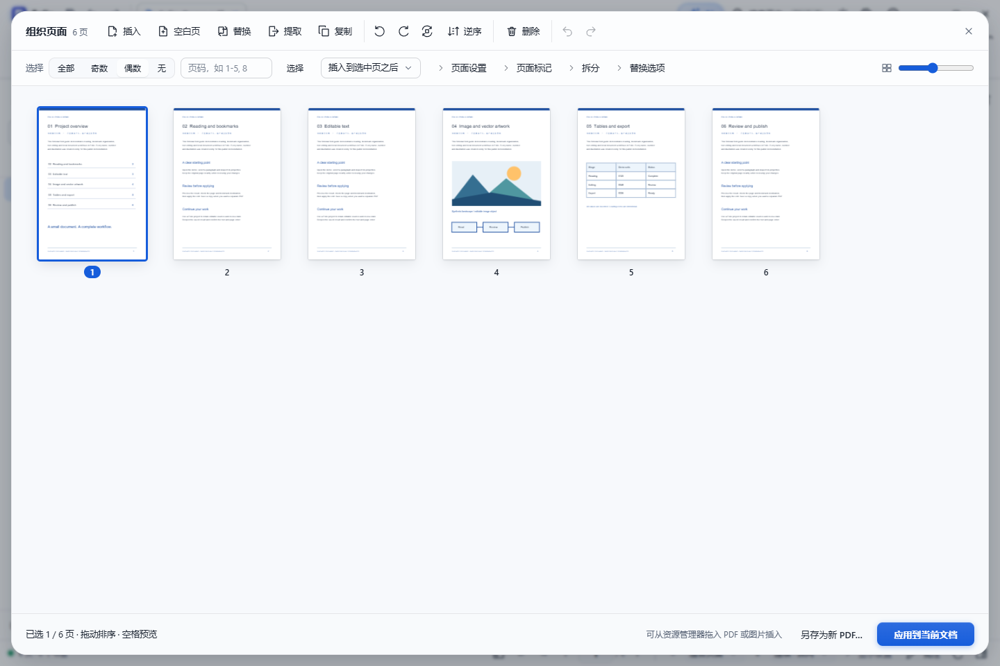
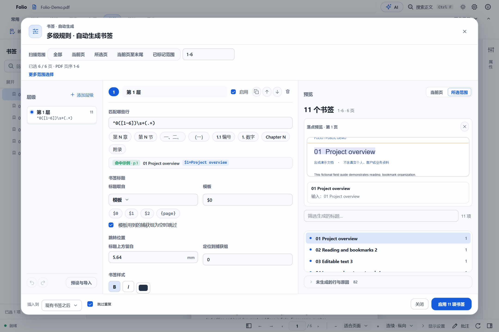
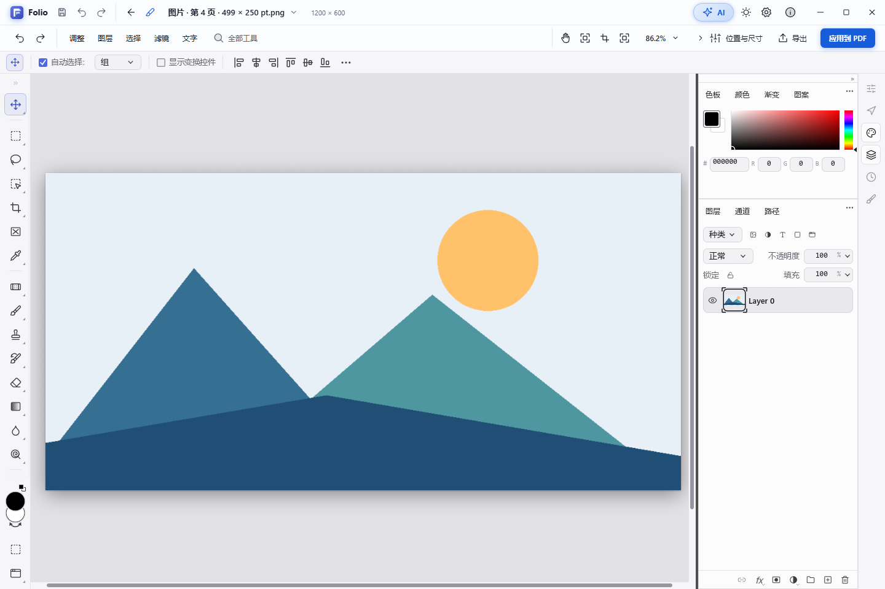

# Folio PDF Studio

**English** · [简体中文](README.zh-Hans.md) · [繁體中文](README.zh-Hant.md)

A local-first PDF workspace for Windows x64, built for **long-document bookmarks, in-page text and image editing, OCR review, and optional Chatbox AI assistance**. The portable package includes its runtime, fonts and models. No separate Python or Node.js installation is needed.

**Folio 2.8.4** lets you begin typing at the original text position in supported horizontal paragraphs while Folio prepares the background and font. It also fixes incremental PDF saves that could give Adobe Reader XI error 14. [Release history](docs/HISTORY.md).

[Download the Windows x64 portable ZIP](https://github.com/ionize1080/Folio/releases/download/v2.8.4/Folio-PDF-Studio-2.8.4-portable-win-x64.zip) · [2.8.4 release notes](docs/RELEASE-2.8.4.md) · [AI user guide](docs/AI.en.md) · [Documentation](docs/README.md)

Open a PDF, press `Ctrl+Shift+P` and type `bookmark`. Use ↑ or ↓ to select a command and Enter to run it. Try `tone` to change the paper color while reading. [Illustrated feature tour](docs/FEATURES.md) · [Open the demo PDF](docs/examples/Folio-Demo.pdf)

## Open your first documents

1. Extract the entire portable ZIP and run `Folio.exe`. Keep the DLLs, `resources` and `locales` directories alongside the executable.
2. Select several PDFs or `.folio` projects in **Open**, or drop them into the window together. Each tab keeps its reading position, selection, undo history and pending edits. Ctrl+Tab and Ctrl+Shift+Tab cycle through tabs. Ctrl+W closes the current document.
3. Apply the edit, then choose **Save** to write the current PDF. With original-file protection enabled, the first save prompts for a copy. Closing an ordinary PDF with pending changes offers Save, Discard or Cancel. For continued work on paragraph structure or reviewed OCR, choose **Export → Save .folio project**.
4. Open **Preferences** to choose Cobalt, Celadon, Amber, Mulberry, Graphite or a custom accent. Appearance supports system, light and dark modes. Interface language follows Windows by default. An explicit language choice takes precedence.

## Upgrade an existing copy

In **About → Check for updates**, download the update and choose **Install and restart**. To upgrade manually, close Folio, extract the entire new ZIP into a separate folder, launch its `Folio.exe` and check the version in **About**.

The release also includes a [source archive](https://github.com/ionize1080/Folio/releases/download/v2.8.4/Folio-PDF-Studio-2.8.4-source.zip), [checksums](https://github.com/ionize1080/Folio/releases/download/v2.8.4/Folio-PDF-Studio-2.8.4-SHA256.txt) and a [validation report](https://github.com/ionize1080/Folio/releases/download/v2.8.4/Folio-PDF-Studio-2.8.4-validation.json).

## Work with Chatbox

Click **AI** and configure your provider, API credentials and tool-capable model in Chatbox settings. Use a vision-capable model to inspect images. Chatbox can compare open documents, report the current physical page and selection, cite pages in a summary, or generate and revise bookmarks.

For a photo, ask for a whole-image preview, then a close-up to check a curve or filter. Apply your chosen candidate at source resolution. For a faded scan, ask for both contrast enhancement and local OCR. You can also replace a rectangle with a local image or embed a flowchart and edit it after reopening the PDF. Generating new pixels requires a separately configured model in **Chatbox Settings → Image Model Provider**. See the [workflow examples and tested scope](docs/AI.en.md).

## Features

### Reading and document operations

Single, continuous, two-page and horizontal layouts; thumbnails, zoom, fit page/width, view history, text selection/copy, search, collapsible panels and themes. Pages and high-zoom tiles render on demand with cache budgets and stale-task cancellation.

Annotations, rotation, extraction, PDF appending, PNG export, metadata editing, password handling and local qpdf/pikepdf password-free copies are included. The legacy extraction/append commands have narrower behavior: extraction uses the original PDF and does not copy the entire bookmark tree; save first before appending. For assembling pages with applied edits, use **Organize → Page organizer**, preview the page order, then apply to the document or save the assembled PDF. Save and reopen before PNG export if new annotations must be included.

### Bookmarks and automatic outlines

Use **Auto bookmarks** for rule-based headings and **Smart table of contents** to reconstruct entries from contents pages. Both are available on the toolbar. Review the proposed physical pages before applying. [Independent TOC page calibration](docs/TOC-PAGE-CALIBRATION.md)

| Capability | Included |
| --- | --- |
| Tree editing | Siblings/children, rename, multi-select, cut/copy/paste, drag, indent/outdent, expand/collapse, undo |
| Properties | Styles, colors, physical pages, coordinates, zoom, destination modes and original-action provenance |
| Filtering | Text/regex, case and page; select true matches while displaying ancestor paths |
| Batch rules | Find/replace, prefixes/suffixes, numbering, whitespace, destination parameters, difference previews and reports |
| Generation | Multi-level regex, capture-group titles, font sizes, pasted contents and page intervals; current-page or range preview |
| Text reconstruction | Baseline tolerance, column separation, optional multiline headings, conflict/missing-parent diagnostics |
| Insertion/deduplication | Append, replace, insert before/after/as child; parent/title/page and position-tolerance deduplication |
| Regex splitting | Sibling or hierarchical outputs, full-original-title evaluation, preview, child migration and destination inheritance |
| Calibration/margins | Match titles to page positions; rotation-aware visual top spacing in mm/pt |
| Rule memory | Recent rules, favorites, presets and import/export; restored rules require fresh previews |
| Exchange | Folio JSON and contents TXT; no proprietary PDF-XChange exchange format |

Review ranges and coordinates before applying. Cross-file import converts resolvable local destinations rather than copying original action dictionaries blindly.

### In-page text, fonts and tables

Click a paragraph to edit. Character controls include font, size, bold/italic and color. Paragraph controls include alignment, spacing, indentation, columns and Format Painter. Shift-drag constrains frame movement; arrows nudge by 1 pt, or 10 pt with Shift.

Supported small changes retain original glyph geometry. Larger edits use local line reflow or MuPDF Story. Limited same-length corrections can reuse original font resources; other edits use verified content fragments. Font matching uses coverage, outlines and widths across embedded, bundled and local fonts.

Paragraphs can be split, merged, linked within a page and manually structured. Overlap/overflow notices allow continued editing; unreliable source mapping and missing glyph coverage still block unsafe writes. Compare paragraph or full-page output before saving.

Simple ruled tables support cell text, row heights, row/column insertion/deletion, widths, rectangular merging/splitting, preview and undo. CSV/XLSX export preserves text, leading zeros and merged ranges. Structural editing stays within the original bounds and is limited to 1,000 cells.

In **Edit text**, click the paragraph and make a short correction. Press `Ctrl+Enter` to finish, save a copy and reopen it to check the changed line and its neighbors.

On page 23 of a 45-page Traditional Chinese interim report, a two-character replacement left 430 unaffected character positions and all sampled pixels outside the edit unchanged. In the same local comparison, preparing two tagged paragraph backgrounds took 0.420 s and 0.939 s, down from 1.468 s and 2.094 s. These timings measure background preparation. First entry into edit mode and applying a character missing from the font can still take several seconds.

### Images and selection

Choose **Edit image**, then click a page image. Changes preview in place and apply at source resolution. Tools include brightness/contrast, levels/histograms, curves, exposure, hue/saturation, vibrance, color balance, black-and-white, channel mixing, photo filters, LUTs, selective color, inversion, posterization, threshold, gradient maps, clarity, dehaze, blur, sharpening and grain.

Levels provide input/output handles, channels, numeric controls and samplers. Curves provide points, pencil drawing, smoothing, grids and on-image adjustment. Crop on the page using ratios, guides, rotation, straightening and perspective correction. Enter confirms; Esc cancels. Crop can be reset before saving.

Hand, text and object-selection tools support box selection, Ctrl/Shift modifiers and batch edits. Replacement images support contain, fill and stretch. The quick image-adjustment path uses 8-bit RGB; the integrated artwork workspace also supports 16/32-bit source documents and color-managed workflows.

### Offline OCR

RapidOCR and ONNX Runtime CPU provide PP-OCRv6 small and PP-OCRv5 mobile profiles. Select pages or a region, 180/240/300 DPI, and automatic/custom resource limits. Results save page by page; stop while retaining results and resume with the same settings.

Review text against the scan, inspect orientation candidates, confirm/defer entries and correct text or geometry. Applying creates a searchable hidden text layer and retains the scan. Unconfirmed issues require review or exclusion. Language checkboxes guide notices and do not expand model capabilities. Simplified/Traditional conversion retains original recognition text and confidence. Hidden-text corrections do not change visible text in the image.

### Export and printing

Use **Export → Word / Excel** for local DOCX/XLSX output. Review reading order, tables and pagination; coverage reports are not visual fidelity scores. **Print** provides booklet and handout layouts with a preview. See the [illustrated workflow](docs/FEATURES.md).

### Projects, recovery and large files

`.folio` V2 uses ZIP STORE for the original PDF, state, immutable assets and a hash manifest. It reads V1 projects; older applications cannot read V2 output. Workers, streamed saves, temporary files and atomic replacement protect existing files. IndexedDB recovery checks integrity and retains the last complete snapshot on quota failure.

PDFs above **768 MiB** enter a separate file-backed workspace, up to **8 GiB**, for reading, bookmarks, regex previews and saving a copy. It does not provide page editing, OCR, full-text search, projects or automatic recovery. Sparse-file checks above 4 GiB validate offsets, not performance for every real multi-GB yearbook. Projects are limited to 1 GiB. These budgets are not total-process memory caps.

## Shortcuts

| Shortcut | Action |
| --- | --- |
| `Ctrl+Shift+P` | Open the command palette |
| `Ctrl+B` / `Ctrl+I` | Bold / italic in the active paragraph |
| Ctrl+O / Ctrl+S / Ctrl+Shift+S | Open / Save / Save as |
| Ctrl+Tab / Ctrl+Shift+Tab / Ctrl+W | Next document / Previous document / Close current document |
| Ctrl+F / F3 / Shift+F3 | Find / Next / Previous |
| Ctrl+Z / Ctrl+Y | Undo / Redo, prioritizing the active editor |
| Ctrl+Shift+B | New bookmark from selection/current view |
| F2 / Delete | Rename / Delete selected subtree |
| Ctrl+0 / Ctrl+1 / Ctrl+2 | Fit page / Actual size / Fit width |
| Alt+Left / Alt+Right | View history; indent/outdent inside the bookmark tree |
| Ctrl+Enter | Finish paragraph; confirm and advance in OCR review |

Shortcuts are focus-aware and configurable. Tab moves focus. Language selection supports the keyboard and uses native names rather than flags.

## Architecture

| Layer | Modules and responsibility |
| --- | --- |
| Desktop | Electron, `main.cjs`, `preload.cjs`: document tabs, dialogs, restricted IPC, workers and updates |
| Workspace | HTML/CSS, ES modules, PDF.js: rendering, selection, editing and review |
| AI client | Chatbox 1.20.3, `integrations/chatbox/`, `ai-host.cjs`, `ai-dock.cjs`: native provider settings, sidebar/window modes, authenticated pipe and stdio |
| On-demand tools | `src/ai-*.mjs`, `integrations/pdf-server.py`, `integrations/pdf_objects.py`: document context, raster and vector edits, and access to 62 file-level PDF tools |
| Storage budget | `storage-budget.cjs`: 2 GB default, protected active files, LRU rotation and temporary large-task expansion |
| Localization | `src/i18n.mjs`, `src/locales/`: offline catalogs, locale persistence, UI translation and user-content exclusions |
| Structure | pdf-lib, Web Workers: bookmarks, annotations, rules, filters and projects |
| PDF engine | Python, PDFium, PyMuPDF, pikepdf/libqpdf: objects, geometry, composition and writeback |
| Fonts/layout | `native/font_*`, `native/fast_layout.py`, `native/original_patch.py`, MuPDF Story |
| OCR | `ocr-jobs.cjs`, `native/worker.py`, `src/ocr-*.mjs`: tasks, diagnostics and corrections |
| Images/tables | `src/image-*.mjs`, `native/image_*`, `src/table-*.mjs`, `native/table_*` |
| State/save | `src/project*`, `src/recovery.mjs`, `source-store.cjs`, `file-store.cjs`: assets, recovery and atomic saves |

The original PDF remains the session baseline. Content is composed, bookmark provenance is checked, and then the output is written. Displaying a PDF does not imply every object can be rewritten losslessly. See the [current architecture and data flows](docs/ARCHITECTURE.md) and [documentation index](docs/README.md).

## Limitations

- Unembedded fonts, unusual encodings, Type3, complex shaping, unsupported directions and nonstandard page units may remain read-only or require explicit fallback fonts.
- Saving/reopening may split paragraphs. Searchable text does not prove that original spaces, code formatting and all glyph positions were retained.
- OCR can omit characters, misread orientation or merge across cells. Confidence does not establish completeness; review output.
- Cross-page reflow, arbitrary image wrapping, complex/borderless/nested tables and structured equation editing are not fully supported.
- Folio has no full interactive form, secure-redaction or digital-signing interface. File-based PDF MCP supplies corresponding upstream tools; these operate on separate files and require review. Proprietary PDF-XChange bookmark exchange is unsupported. Rewriting may invalidate signatures.
- Ordinary edits and projects retaining original content are not secure redaction. Off-page content is clipped on export.
- Automated Windows acceptance does not cover every real IME, mixed-DPI setup or hardware combination. Linux engine tests do not imply a Linux desktop release.

## Development and verification

The Windows build uses Node.js 24, Python 3.12, pinned native resources and the Chatbox source integration. The Windows workflow runs the native editing and saving tests, checks the portable ZIP and exercises the updater. The [2.8.4 pre-merge run](https://github.com/ionize1080/Folio/actions/runs/44871390695) passed all 46 acceptance jobs, including six packaged test groups. The [2.8.4 release run](https://github.com/ionize1080/Folio/actions/runs/44876808220) rebuilds and checks the merged commit. Real Qwen image generation and reference-image editing use separate provider settings.

In Adobe Reader XI 11.0.10.32, the first and second incremental saves from 2.8.3 reproduced error 14 on a PDF with a cross-reference stream. Both direct 2.8.4 saves and new incremental saves of the affected old file opened and yielded the expected text. Twelve additional files covered Chinese paragraph edits, redo and linearized PDFs. [Error 14 comparison](https://github.com/ionize1080/Folio/actions/runs/44871005460/job/136745299657) · [Additional Reader XI cases](https://github.com/ionize1080/Folio/actions/runs/44870462512/job/136743594117)

[Developer setup and test commands](docs/DEVELOPMENT.md) · [Verification scope](docs/VALIDATION.md) · [Locale contributions](docs/LOCALIZATION.md)

## Scope for further work

Complex paragraph reflow, OCR review on difficult layouts and performance on real multi-gigabyte files remain areas for further testing. For older installations with a blocked updater, the historical compatibility notes describe the manual portable upgrade. [Planning archive](docs/NEXT-RELEASE-PLAN.md) · [Updater compatibility](docs/RELEASE-2.0.1.md)

## Licensing

Folio code uses MIT. The portable distribution includes Chatbox, MuPDF, PDF MCP, fonts, models and runtimes under their respective licenses. [Folio license](LICENSE) · [Third-party notices](THIRD-PARTY-NOTICES.md)
