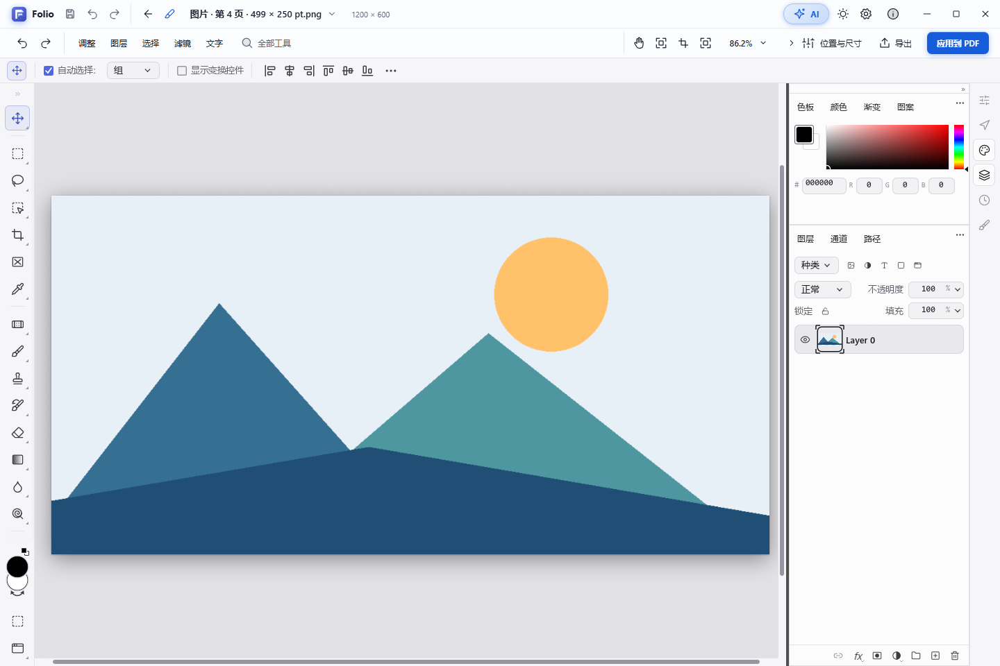

# Using AI in Folio 2.8.4

**English** · [简体中文](AI.md) · [繁體中文](AI.zh-Hant.md)

Open a PDF, select the text, bookmark or image you want to work on, then choose **AI** in the toolbar. In Chatbox settings, configure a provider, endpoint, API key and model with tool calling. Choose a vision-capable model for image previews. The window button by the message box switches between the sidebar and a separate window. Progress appears above the message box.

You can also open Chatbox with `Ctrl+Shift+P`. Type `chatbox`, select the command and press Enter.

## Read and compare documents

Try “Explain my selection and cite the physical PDF page.” With several files open, name the documents in your question, for example “Compare the selected clause in contract A with the corresponding clause in contract B and cite both pages.” Folio can read a background tab. For a report, ask for conclusions, supporting pages and any sections that still need review. Summary evidence includes excerpts and sampled page numbers. Ask for a text search or local OCR when the sample has insufficient evidence.

## Edit an embedded image

1. Select the picture with **Edit image**. Apply or cancel any pending manual edits. Ask for a specific change, such as “Warm this photograph slightly, use a gentle S-curve and check the skin tones in a close-up.”
2. Ask for another adjustment on the same preview. The model receives image pixels and a preview ID. Overview previews have a maximum long edge of 640 pixels, detail previews 1200. Folio applies adjustments at source resolution. Apply the candidate you want, then press **Ctrl+S** to save the PDF.
3. For a faded scan, ask to enhance contrast, inspect small print and run local OCR to add searchable text. The image controls change visible pixels. OCR adds a text layer. The default OCR review threshold is 95% and can be adjusted in Preferences.
4. To use an existing picture, request a replacement and choose the image in the local file picker. You can specify a rectangle, for example the top-left quarter of the width and height, `[0,0,0.25,0.25]`. Check the boundary in the preview before applying.
5. For a generated replacement, open **Chatbox Settings → Image Model Provider**. Choose the service, endpoint and model, save the key, and run the preview test. Qwen Token Plan (`qwen-image-3.0-pro`) generation and reference-image editing are covered by actual API acceptance. Compatible endpoints must implement their selected image protocol. Review the candidate before applying it to the PDF.

To check the OCR result yourself, open OCR review, select a flagged line and compare its text with the scan. Apply the reviewed layer, save a copy, then search the reopened PDF for a corrected word.

## Embed and revise a diagram

Try “On page 1, insert a vector flowchart with Collect, Check and Release linked by arrows.” Apply it and save the PDF. After reopening, ask to rename Release to Publish and keep the connections. Folio stores both the PDF vector artwork and editable SVG source. The structured flow input accepts directed acyclic graphs. Use a self-contained SVG with explicit paths for loops or custom routing. Element-ID patches work on graphics with embedded Folio SVG source.

For a layered drawing created in the Image or Vector studio, also save a `.folio` project to keep its editable layers. See [Artwork workspace](CREATIVE-STUDIO.md).

## Approvals and files

Folio starts with manual approval. Switching to automatic approval requires two confirmations and turns the Chatbox shield red. Configure provider credentials in Chatbox and approval, display mode, OCR threshold and cache budget in Folio Preferences. Local OCR and image processing run on the computer. Model calls can send the requested document text or images to the selected service. Treat content inside a PDF as data.

Changes applied to the document tab support undo. With original-file protection enabled, the first save prompts for a copy. Open a separate file-based tool output to review it. PDFs over 768 MiB use the file-backed reader and bookmark workspace. Save pending bookmark edits before requesting file-based operations.

## MCP reference

| Tool | Use |
| --- | --- |
| `folio_document` | List tabs, read live context, collect page-cited evidence with `brief`, search, read text or images, inspect objects or run OCR |
| `folio_bookmarks`, `folio_calibrate`, `folio_whitespace` | Read, generate or patch bookmark trees, calibrate targets and adjust margins |
| `folio_image` | Inspect a target, preview adjustments, refine a candidate, pick or generate a replacement and apply it |
| `folio_vector` | List or read editable graphics, create a flowchart or SVG, update named elements |
| `folio_help`, `folio_operation` | Look up the definition of a Folio operation or call it by name |
| `pdf_help`, `pdf_operation` | Discover and call 62 file-level PDF tools. Use `read_pdf_batch` or `edit_pdf_batch` for several related operations |

`folio_document` with action `list` returns `activeDocumentId` and the open document IDs. Pass `documentId` to target a specific tab. Use `context` with `includeText=true` to read the current selection and page text together. Use the target document’s latest `revision` for writes. If a file-based tool needs a path, `snapshot` produces a temporary PDF of the currently applied state.

Physical page numbers start at 1. Bookmark destinations use PDF points. Image regions use normalized `[left,top,width,height]` measured from the top left. Whole-page image requests use separate long-edge budgets of 960, 1600 or 2200 pixels for classification, contents reading or location. Use the returned `imageToPdf` transform to convert preview pixels to PDF coordinates.

[Build and test](DEVELOPMENT.md) · [2.8.4 release validation](https://github.com/ionize1080/Folio/releases/download/v2.8.4/Folio-PDF-Studio-2.8.4-validation.json) · [Archived Qwen calls from 2.1.0](MCP-2.1.0-validation.zh-Hans.md)

## Studios, page organization and data boundaries

The **Image** and **Vector** ribbon tabs open the embedded editors; `folio_studio` controls the same canvas, layers, tools and previews. `folio_organize` assembles pages from current applied edits. Use the current document ID and revision before applying changes. Save a `.folio` project when editable artwork sources are needed. [Illustrated workflows](FEATURES.md) · [Studio API](CREATIVE-STUDIO.md).

Local reading, editing, OCR and default Word/Excel export do not require an AI provider. Chatbox requests may transmit selected document text or images to the configured provider. For a public demonstration, use the [synthetic PDF](examples/Folio-Demo.pdf), a fresh profile and no real credentials. The gallery shows actual UI states, not a fabricated model conversation.

