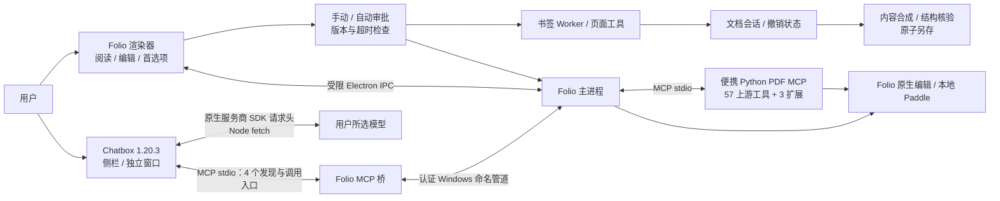

# Folio 2.0.0 当前架构

更新：2026-11-04。本文描述 2.0.0 的实际模块与数据流；早期设计见 [0.6](ARCHITECTURE-0.6.md)、[0.7](ARCHITECTURE-0.7.md) 和 [P6 审计](RC1-P6-editor-audit.md)。使用入口见 [AI 指南](AI.md)，测试范围见 [2.0.0 发布记录](RELEASE-2.0.0.md)。

Folio 保留本地阅读、编辑、书签规则和 OCR 引擎，引入独立 Chatbox 1.20.3 进程作为可选 AI 客户端。模型配置与会话归 Chatbox；当前文档状态、审批和保存归 Folio。外部模型可以请求文字、整页或局部图像，也可以调用经过审批的文档工具。AI 不直接改写活动会话对象。

## 进程与通信

MCP 没有 HTTP、SSE 或 TCP 服务。Folio 与 Chatbox 的窗口控制及文档桥使用随机管道名和令牌；PDF 服务使用同步 stdio，诊断写 stderr。少数上游内部代码需要 socketpair 时使用本地 AF_UNIX，而不建立 TCP 唤醒端口。

PDF 服务适配器拒绝网络 socket 调用，其远程 LLM、远程时间戳等能力不能联网。外部模型请求走 Chatbox 当前服务商。Chatbox 自带更新与统计上报关闭，组件随 Folio 更新；Folio 更新访问 GitHub。该设计不等同于操作系统级进程沙箱。

## AI 与界面模块

| 模块 | 职责与边界 |
| --- | --- |
| `src/ai-ui.mjs` | 单一 AI 工具栏入口；首选项状态、审批、请求队列、会话版本校验、图像与 OCR 调用；自动审批只在当前会话生效 |
| `src/ai-tools.mjs` / `src/ai-worker.mjs` | 23 项 Folio 操作的按需目录和参数；复用书签模型、生成、拆分、留白引擎，在 Worker 中执行树计算 |
| `ai-host.cjs` | 认证命名管道、渲染器请求、超时、快照租约、Chatbox 生命周期和 Python stdio 客户端 |
| `ai-dock.cjs` / `integrations/chatbox/dock.ps1` | Windows 原生窗口嵌入、DPI 坐标、侧栏/独立窗口切换；Folio 对话框打开时隐藏嵌入窗口 |
| `integrations/chatbox/bootstrap.cjs` | 加载固定官方组件，注入不含密钥的初始 Qwen 配置与 stdio MCP；保留用户原生服务商与模型设置 |
| `integrations/chatbox/controls.js` | 原生输入栏中 28 px 容器、18 px 图标、4 px 间距的窗口/审批快捷操作，继承 Chatbox 主题色 |
| `integrations/chatbox/network*.js` / `network*.cjs` | 将原生 provider SDK 的请求头与流式消息交给 Node fetch，避免 Electron 网络层请求头；支持取消 |
| `integrations/chatbox/vision*.js` / `vision-body.cjs` | 将 MCP 图像结果转换为真正视觉附件，避免将 Base64 当工具文本消耗 token |
| `integrations/pdf-server.py` | 固定上游完整注册表、参数校验和同步 stdio；禁用网络 |
| `integrations/pdf_objects.py` | 29 项 PDF 对象操作与按页本地 Paddle OCR；对象写入要求新输出路径 |
| `storage-budget.cjs` | 统一可轮替文件登记、最近使用顺序、保护租约、默认 2048 MB 上限和临时扩容 |

主工具栏只保留 AI 聊天气泡入口，避免与自动书签的星形、OCR 的扫描框重复。OCR 阈值、审批和显示方式收纳到首选项；API/服务商/模型继续使用 Chatbox 原生设置。左右面板使用对应方向的图标。再次点击 AI 可收起侧栏，属性面板入口会恢复属性；独立窗口模式下点击 AI 聚焦 Chatbox。

## 按需能力链与审批

Chatbox 只常驻 `folio_help`、`folio_operation`、`pdf_help`、`pdf_operation` 四个工具，不预先塞入所有 PDF 参数。模型先查询目录，再查询具体工具结构，最后显式传 operation 与 options。帮助查询不会隐式选择下一步操作。`folio://guide` 提供常用组合流程。

- **活动文档**：先读取 `document.describe` 的 revision；获取当前树、页面文字/图像或对象；提交书签或页面修改时核对最新版本。树替换、移动、复制、生成、拆分和校准复用 Folio 引擎；成功后进入撤销历史。用户切换文档或请求超时后，旧结果不能继续落入新会话。
- **文件式 PDF 操作**：通过已保存文件或 `document.snapshot` 获取输入；`pdf_help` 查询完整结构后调用。60 个工具包括 57 个上游工具、底层对象 help/operation 和本地 OCR。文件结果不会自动同步回编辑器，也不进入当前文档的撤销历史；需要另存、审阅并重新打开。
- **书签底层**：完整读取/替换树、父子关系、次序、标题、样式、展开状态、目标页和原生目标参数；还可通过 PDF 对象层处理 outline、xref 字典/流、页面框、标签、链接、附件和 XML 元数据。
- **审批**：启动默认手动；文字/图像内容读取、OCR、修改和文件工具按规则请求批准。切到自动需两次确认，Folio AI 和 Chatbox 盾牌标红；模型的工具列表没有改变审批模式的入口。帮助和文档基本信息不弹重复确认。

模型结果与 PDF 文字均视为待检查数据。原生坐标和图片像素不能混用；无完整目标或缺页码的创建请求报错，不能默默落到第一页。

## OCR 与视觉辅助

本地 PP-OCRv6 ONNX 模型优先；默认低置信度复核阈值 95%，可在首选项或单次工具参数中调整。模型可以复核疑难字词或复杂版面，不能伪造提高原始置信度。应用校对保留原文字与审阅标记。

图像分辨率由任务用途决定：classify 最长边约 960 px、toc 约 1600 px、locate 约 2200 px；还受最多 3 倍缩放和像素预算约束。支持整页或归一化局部区域。返回 `imageToPdf=[a,b,c,d,e,f]`，按 `X=a*x+c*y+e; Y=b*x+d*y+f` 映射坐标，包含页面框偏移与旋转影响。模型可先低分辨率判断目录候选，再高清读取和局部定位。

大文件使用文件式 `pdf_local_ocr`，先抽取单页再调用本地模型。独立大文件工作区有未保存修改时不对模型提供可误用的旧文件路径，应先保存。

## 核心文档与编辑引擎

原始 PDF 在一个文档会话内保持不变。编辑状态描述书签、批注、旋转、OCR 与内容修改；PDF.js 共享原始文档，只为已修改页面显示独立合成预览。工程打开完成解包、哈希核对、结构解析和预览准备后再替换活动文档。保存先合成内容，再核对原始动作并写结构，最后以同目录临时文件替换目标。

| 模块 | 当前职责 |
|---|---|
| `src/app.mjs` | 命令协调、活动状态和对话框；尚未完全拆分，后续按实际依赖继续缩减 |
| `src/session-state.mjs` | 文档身份、修订号、过期结果拒绝、首选项逐字段校验 |
| `src/native-source.mjs` / `source-store.cjs` | 源 PDF 注册与只读句柄；工作请求持有租约，关闭会话后等租约结束再删除 |
| `native-bridge.cjs` | 进程内请求串行、取消代次、命令/页码诊断、合成和页面背景缓存 |
| `flow-layout.cjs` / `flow-validation.cjs` | 专用 Story 排版进程与模型验证；产品不加载旧 Chromium 排版器 |
| `main.cjs` / `preload.cjs` | 狭窄 IPC、发送者验证、文件能力票据；内容、背景、字体、排版、qpdf 分开进程 |
| `src/model.mjs` / `src/edit-assets.mjs` | 小状态撤销记录、不可变 OCR 与内容版本引用、资源预算；大型片段不进入历史 JSON |
| `src/project.mjs` / `project-worker.mjs` / `zip-store.mjs` | 工程 v2 的 ZIP STORE、完整性清单和 Worker 编解码；继续读取 v1 JSON 工程 |
| `src/portable-state.mjs` | PDF 碎片与文字几何的内容寻址资产、共享序列化缓存、状态验证 |
| `src/recovery.mjs` | IndexedDB v3，多会话键、源/碎片去重、完整性核对、默认 2 GB 可配置预算，保护未保存草稿、失败保留旧快照 |
| `file-store.cjs` | 文件选择票据、原件保护、分块写入、刷盘后替换；失败保留目标原内容 |
| `temp-store.cjs` | 带进程所有者记录的临时目录；仅清理确认所有者已退出的本产品目录 |
| `src/flow-ui.mjs` | 页上编辑、IME 草稿、连续选段意图、局部/整段排版、拆分合并与人工结构锁定 |
| `src/fast-layout.mjs` / `native/fast_layout.py` | 编辑区即时排版和 PDF 字形写回，复用原字体分数字宽和局部行锚点；ActualText 保留逻辑文本 |
| `native/browser_fonts.py` / `native/font_sfnt.py` | 浏览器字体修复、Type1/CFF 封装、CID 映射、原字形/字宽保留及无效字体负缓存 |
| `native/font_similarity.py` | 有界单字形轮廓/掩码缓存，先检查覆盖和嵌入条件；界面过滤过期推荐 |
| `src/page-preview.mjs` | 按修改页生成预览；撤销、失败回滚及原 PDF 的共享所有权 |
| `large-files.cjs` / `native/large_pdf.py` / `src/large-workspace.mjs` | 超过 768 MiB 的独立阅读与书签工作区，受控磁盘句柄和增量书签另存 |
| `native/original_layout.py` | 原字位与局部行布局；支持同原点扩宽，复杂脚本/格式改变交给 Story |
| `native/original_patch.py` | 单对象、单行、等字符数、已有编码且不增宽的局部纠错；原字体资源与原字位保持，TJ 补偿字宽变化 |
| `native/content.py` | 对象签名验证、原内容操作保留、版本化 Form 合成；无法证明安全的修改拒绝或使用片段 |
| `src/pdf-core.mjs` | 书签与动作保真；合成后核对动作语义，来源不一致则停止保存，不默默降级目标 |
| `ocr-jobs.cjs` | 独立 OCR 工作者、逐页结果和校对、显式应用结果；缓存清理保留校对记录与当前引用 |
| `src/viewer.mjs` | 页面和瓦片虚拟化、缓存预算、取消旧渲染、缩放锚点 |

## 存储、大文件与保护

普通工作区源 PDF 上限 768 MiB，工程上限 1 GiB；这是格式/处理路径限制，和磁盘缓存预算不同。超过 768 MiB 使用独立大文件工作区，其入口上限 8 GiB，主要提供按页阅读、书签和另存；文件式 PDF MCP 可以读取、渲染与按页 OCR。712 MB / 806 页样本已做文件式工具和单页 OCR 实测，不能外推为任意 8 GiB 文档的性能保证。

可管理磁盘缓存默认 **2048 MB（2 GB）**，首选项可配置。内容缓存、旧 AI 快照按最近使用时间轮替；活动原件句柄、当前快照和原子保存临时文件计入占用但固定保护。受保护文件超过配置值时临时提高有效上限，释放后清理可轮替文件，避免为了满足配额删除正在使用的大文件。

OCR 清理从共享预算剩余额度回收旧输入和无引用结果，保留当前任务、引用和已校对数据。IndexedDB 恢复存储采用同一配置值，单个大草稿可临时扩容；新快照写入失败保留上一份完整快照。用户文件、聊天记录、随包模型和未保存草稿不作为可随意清理的缓存。因此 2 GB 不是安装目录、用户数据总量或进程内存硬上限。

`.folio` v2 包含 `source.pdf`、`state.json`、`assets/<sha256>.pdf/json` 和 `manifest.json`。Worker 编解码、内容寻址去重和分块保存减少重复复制；校验失败不加载不完整工程。原子保存刷盘并核对目标版本后替换，失败保留原目标。

## 构建、测试与许可

- `npm run test:quick`：单元及源码/发布传输检查。
- `node scripts/acceptance.mjs native`、`node scripts/acceptance.mjs browser`：编辑保真与浏览器事务回归；`npm run test:full` 组合通用阶段。
- `tests/ai-integration.cjs`、`tests/ai-settings.cjs`：审批、版本、工具、设置与布局；`tests/pdf-mcp-bridge.cjs`：便携 stdio 和底层写入保护。
- `tests/ai-corpus.cjs`、`tests/pdf-corpus.cjs`：真实文档；`tests/ai-model-corpus.cjs`：实际 Chatbox / API / MCP 五类工作流；`tests/verify-ai-results.py` 独立核对保存的 PDF。
- `npm run build:win`、`npm run test:package`、`tests/package-ai.cjs`：构建、源码/组件哈希和实际 EXE、窗口模式、便携 Python、端口检查。仅开发测试显式启用调试端口，发行版忽略对应开关。

原生运行时、Chatbox、Python PDF MCP 均随便携包提供。`scripts/prepare-chatbox.cjs` 验证官方 1.20.3 app.asar 并按锚点应用适配；`scripts/prepare-ai.py` 验证固定源码提交与资源哈希。详见 [构建步骤](AI.md#构建与测试)。API 测试凭证、用户配置、原始样本、聊天记录及渲染页面不进入发布包。

Folio 自有代码为 MIT；Chatbox 为 GPL-3.0，PyMuPDF/MuPDF 遵循其 AGPL 条款，PDF MCP 为 Apache-2.0，其他组件保留各自许可。源码包含 Chatbox 上游源码 ZIP 和 PDF MCP 固定源码，运行包附修改哈希与许可；根许可证不替代依赖许可。见 [第三方说明](../THIRD-PARTY-NOTICES.md)。
