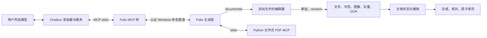

# Folio PDF Studio 2.1.0 架构

每个打开的文件有自己的编辑器、PDF.js 工作者、选区、撤销记录和未保存状态。主进程管理标签和原生文件对话框。Chatbox 1.20.3 使用同一套 Electron 运行时，在侧栏和独立窗口之间切换时复用同一个聊天视图。[用户指南](../README.zh-Hans.md) · [AI 操作指南](AI.md)

## 一次跨文件提问如何执行

1. `document-tabs.cjs` 管理打开的文件和活动标签。首个编辑器承载首页，后续文件使用独立的 `WebContentsView`。打开同一路径可切换到已有标签。关闭标签前，由该文件的编辑器处理未保存修改。
2. `ai-host.cjs` 在收到请求时按 `documentId` 绑定目标编辑器。省略 ID 时绑定活动文档。`folio_document` 的 `list` 返回 ID 列表，`context` 返回物理页码、书签、文字、选区和对象信息。在手动审批模式下，针对另一标签的请求可以切换到目标文档以供核对。
3. 编辑器按文件核对修订号并执行操作。图像预览候选也绑定文件修订。过期的修改请求需重新读取状态；模型不能沿用另一份文件的写入版本号。已应用修改进入该文档的会话，用户执行保存后才写入输出 PDF。
4. 文件式工具通过 `pdf_help` / `pdf_operation` 按需访问 62 个工具。需要当前编辑结果时，`snapshot` 可提供临时 PDF。文件式工具的输出作为单独文件打开和复核。

## Chatbox 和编辑工具

| 模块 | 职责 |
| --- | --- |
| `ai-dock.cjs`、`integrations/chatbox/controls.js`、`progress.js` | 托管 Chatbox，切换侧栏或独立窗口，在输入框上方显示进度。Folio 菜单或弹窗出现时让出原生视图。 |
| `integrations/chatbox/stdio.cjs`、`tool-schema.cjs` | 向聊天模型注册十个入口。六个用于文档、书签、留白、校准、图像和矢量，四个用于帮助和通用操作。 |
| `src/ai-ui.mjs`、`ai-tools.mjs`、`ai-efficient.mjs` | 处理审批、选区、修订和响应分页；用本地索引筛选及修改书签，用物理页码标识摘要证据。 |
| `src/ai-images.mjs`、`native/image_adjustments.py` | 定位嵌入图像，返回候选像素和亮度分位数，按预览 ID 继续调整，在原图上应用色彩、曲线、滤镜或指定区域的替换。 |
| `integrations/chatbox/image-generation.ts` | 用用户在图像创作中选择的服务商和模型生成候选。局部重绘需支持参考图输入。 |
| `src/ai-vectors.mjs`、`native/vector_graphics.py` | 将流程图或经过校验的独立 SVG 嵌入 PDF Form XObject，同时保存 SVG 源码和图形 ID，供重开后继续修改。 |
| `integrations/pdf-server.py`、`integrations/pdf_objects.py` | 本地 stdio 文件服务，包括批量读写、底层 PDF 对象操作与按页 OCR。 |
| `src/appearance.mjs`、`src/controls.css`、`src/i18n.mjs` | 计算配色及可读前景、绘制状态和键盘焦点、解析系统语言及用户覆盖选项。 |

MCP 使用本地 stdio 和认证命名管道。模型联网请求由 Chatbox 的服务商适配处理。手动审批为启动默认值，用户切换自动审批需两次确认。模型可以收到用户请求所需的文字和图像，文档内容按数据处理。

## 预览和完整输出

页面预览与嵌入图像预览采用不同预算。整页工具可以按分类、目录细读和定位选择 960、1600、2200 像素的默认长边预算，并返回像素到 PDF 坐标的变换。嵌入图片的整体和细节预览长边分别最多 640 和 1200 像素，区域坐标从原图左上角计算。滤镜、色阶和曲线写回时处理源图像素。流程图的 PDF 路径及文字保持矢量形式。

扫描增强改变图像像素。OCR 使用本地 Paddle 引擎，复核阈值默认 95%；明确要求写入 OCR 后生成可检索文字层。大文件工作区可通过文件式工具按页识别。独立出图服务的线上验收与已发布的 Qwen 看图、调色和换图测试分别记录。[发布验收](VALIDATION.md)

## 核心文档与编辑引擎

原始 PDF 在一个文档会话内保持不变。编辑状态描述书签、批注、旋转、OCR 与内容修改；PDF.js 共享原始文档，只为已修改页面显示独立合成预览。工程打开完成解包、哈希核对、结构解析和预览准备后再替换活动文档。保存先合成内容，再核对原始动作并写结构，最后以同目录临时文件替换目标。

| 模块 | 当前职责 |
|---|---|
| `src/app.mjs` | 命令协调、活动状态和对话框；尚未完全拆分，后续按实际依赖继续缩减 |
| `src/session-state.mjs` | 文档身份、修订号、过期结果拒绝、首选项逐字段校验 |
| `src/native-source.mjs` / `source-store.cjs` | 源 PDF 注册与只读句柄；工作请求持有租约，关闭会话后等租约结束再删除 |
| `native-bridge.cjs` | 进程内请求串行、取消代次、命令/页码诊断、合成和页面背景缓存 |
| `flow-layout.cjs` / `flow-validation.cjs` | 专用 Story 排版进程与模型验证；产品不加载旧 Chromium 排版器 |
| `main.cjs` / `preload.cjs` | 狭窄 IPC、发送者验证、文件能力票据；内容、背景、字体、排版、qpdf 分开进程 |
| `src/model.mjs` / `src/edit-assets.mjs` | 小状态撤销记录、不可变 OCR 与内容版本引用、资源预算；大型片段不进入历史 JSON |
| `src/project.mjs` / `project-worker.mjs` / `zip-store.mjs` | 工程 v2 的 ZIP STORE、完整性清单和 Worker 编解码；继续读取 v1 JSON 工程 |
| `src/portable-state.mjs` | PDF 碎片与文字几何的内容寻址资产、共享序列化缓存、状态验证 |
| `src/recovery.mjs` | IndexedDB v3，多会话键、源/碎片去重、完整性核对、默认 2 GB 可配置预算，保护未保存草稿、失败保留旧快照 |
| `file-store.cjs` | 文件选择票据、原件保护、分块写入、刷盘后替换；失败保留目标原内容 |
| `temp-store.cjs` | 带进程所有者记录的临时目录；仅清理确认所有者已退出的本产品目录 |
| `src/flow-ui.mjs` | 页上编辑、IME 草稿、连续选段意图、局部/整段排版、拆分合并与人工结构锁定 |
| `src/fast-layout.mjs` / `native/fast_layout.py` | 编辑区即时排版和 PDF 字形写回，复用原字体分数字宽和局部行锚点；ActualText 保留逻辑文本 |
| `native/browser_fonts.py` / `native/font_sfnt.py` | 浏览器字体修复、Type1/CFF 封装、CID 映射、原字形/字宽保留及无效字体负缓存 |
| `native/font_similarity.py` | 有界单字形轮廓/掩码缓存，先检查覆盖和嵌入条件；界面过滤过期推荐 |
| `src/page-preview.mjs` | 按修改页生成预览；撤销、失败回滚及原 PDF 的共享所有权 |
| `large-files.cjs` / `native/large_pdf.py` / `src/large-workspace.mjs` | 超过 768 MiB 的独立阅读与书签工作区，受控磁盘句柄和增量书签另存 |
| `native/original_layout.py` | 原字位与局部行布局；支持同原点扩宽，复杂脚本/格式改变交给 Story |
| `native/original_patch.py` | 单对象、单行、等字符数、已有编码且不增宽的局部纠错；原字体资源与原字位保持，TJ 补偿字宽变化 |
| `native/content.py` | 对象签名验证、原内容操作保留、版本化 Form 合成；无法证明安全的修改拒绝或使用片段 |
| `src/pdf-core.mjs` | 书签与动作保真；合成后核对动作语义，来源不一致则停止保存，不默默降级目标 |
| `ocr-jobs.cjs` | 独立 OCR 工作者、逐页结果和校对、显式应用结果；缓存清理保留校对记录与当前引用 |
| `src/viewer.mjs` | 页面和瓦片虚拟化、缓存预算、取消旧渲染、缩放锚点 |

## 存储、大文件与保护

普通工作区源 PDF 上限 768 MiB，工程上限 1 GiB；这是格式/处理路径限制，和磁盘缓存预算不同。超过 768 MiB 使用独立大文件工作区，其入口上限 8 GiB，主要提供按页阅读、书签和另存；文件式 PDF MCP 可以读取、渲染与按页 OCR。712 MB / 806 页样本已做文件式工具和单页 OCR 实测，不能外推为任意 8 GiB 文档的性能保证。

可管理磁盘缓存默认 **2048 MB（2 GB）**，首选项可配置。内容缓存、旧 AI 快照按最近使用时间轮替；活动原件句柄、当前快照和原子保存临时文件计入占用但固定保护。受保护文件超过配置值时临时提高有效上限，释放后清理可轮替文件，避免为了满足配额删除正在使用的大文件。

OCR 清理从共享预算剩余额度回收旧输入和无引用结果，保留当前任务、引用和已校对数据。IndexedDB 恢复存储采用同一配置值，单个大草稿可临时扩容；新快照写入失败保留上一份完整快照。用户文件、聊天记录、随包模型和未保存草稿不作为可随意清理的缓存。因此 2 GB 不是安装目录、用户数据总量或进程内存硬上限。

`.folio` v2 包含 `source.pdf`、`state.json`、`assets/<sha256>.pdf/json` 和 `manifest.json`。Worker 编解码、内容寻址去重和分块保存减少重复复制；校验失败不加载不完整工程。原子保存刷盘并核对目标版本后替换，失败保留原目标。

## 构建、测试与许可

Chatbox 的渲染器、预加载脚本和主进程服务从固定社区源码构建。准备脚本核验上游提交、官方安装包及依赖，构建产物记录来源和哈希。PDF MCP 扩展通过仓库中的补丁应用到固定子模块。文件服务保留 57 项上游工具，并提供批量读写、底层对象帮助与操作、本地逐页 OCR 共五项扩展。Windows 工作流对打包后的程序、多文件切换和实际更新 ZIP 分别验收。[开发与发布步骤](DEVELOPMENT.md) · [第三方组件与许可](../THIRD-PARTY-NOTICES.md)
