# Folio 2.8.3 — illustrated feature tour

[English](FEATURES.md) · [简体中文](FEATURES.zh-Hans.md) · [繁體中文](FEATURES.zh-Hant.md)

Real Windows application captures using only generated documents and isolated application/Chatbox profiles. No private PDFs, recent-file lists, credentials or personal conversations were used. UI language is Simplified Chinese; captions explain each workflow in English.

[Demo PDF](examples/Folio-Demo.pdf) · [Scan PDF](examples/Folio-Demo-Scan.pdf) · [Provenance and reproduction](SCREENSHOTS.md) · [User guide](../README.md)

The gallery shows current UI and a small demonstration, not an exhaustive acceptance test. For release verification and known boundaries, see [Validation](VALIDATION.md).

## 1. Read and navigate

Open the demo PDF. Use the bookmark tree, page box and bottom zoom controls to navigate; Ctrl+0 fits the page. Each open document keeps its own editing state.

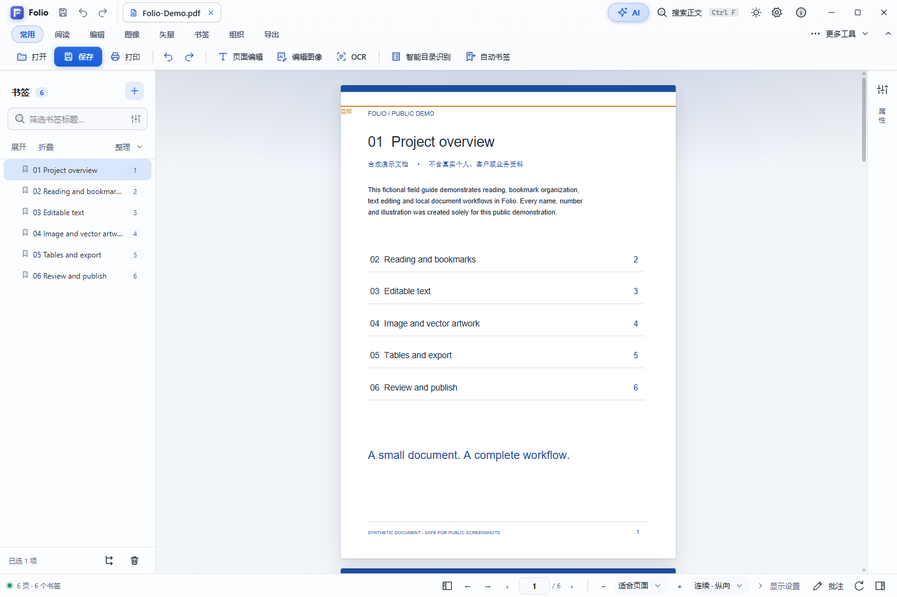

## 2. Generate bookmarks with rules

Open **Bookmarks → Automatic bookmarks**. Choose the page range, define a pattern and review matched headings before applying. The demonstration uses `^0[1-6] +.+` against generated chapter headings. Preview duplicate and hierarchy behavior before importing a long outline.

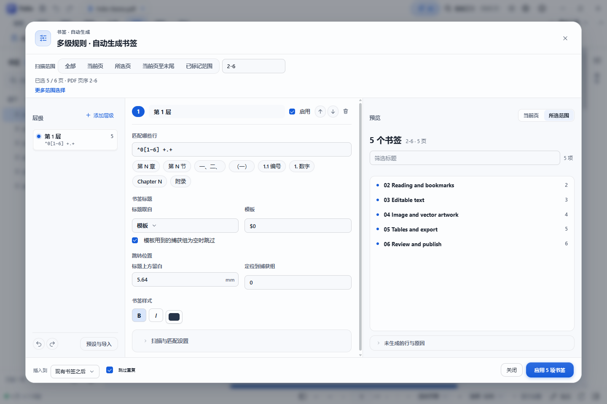

## 3. Review bookmark quality

Open **Bookmarks → Statistics / QC** to inspect the outline. Use target calibration for heading evidence and top whitespace for landing position; these are distinct operations. A quality summary is a review aid, not proof that every heading is correct.

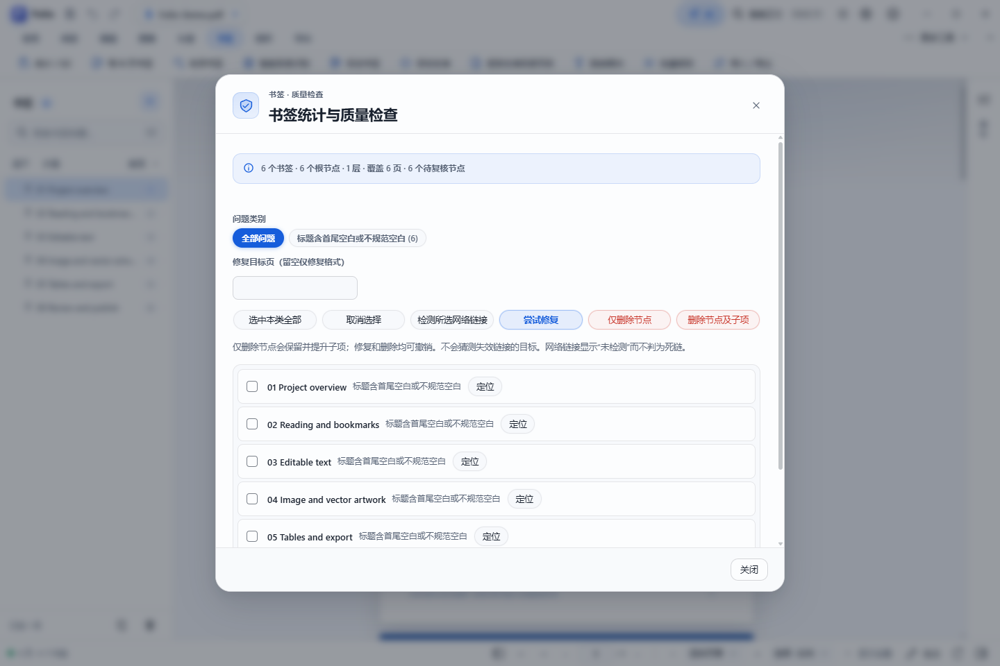

## 4. Arrange pages visually

Open **Organize → Page organizer**. Select thumbnails, reorder with the keyboard or drag, preview with Space, and insert or rotate pages. Review the assembled document, apply it back to the active document and save, or save an independent PDF. The organizer starts from applied edits.

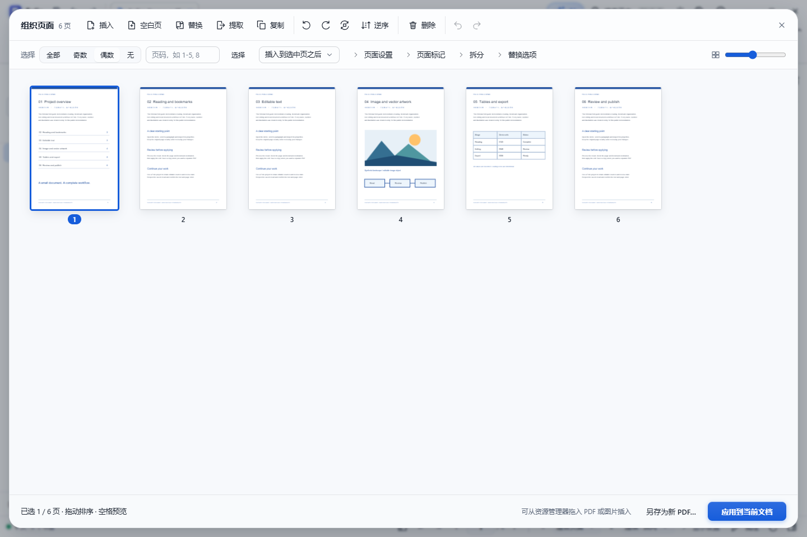

## 5. Edit a paragraph on the page

Choose **Page editing**, then select an editable paragraph. The screenshot shows the live editor on generated text. Check font substitution, layout and overflow, finish the edit and save. Unsupported encodings or complex layouts may require fallback or be refused.

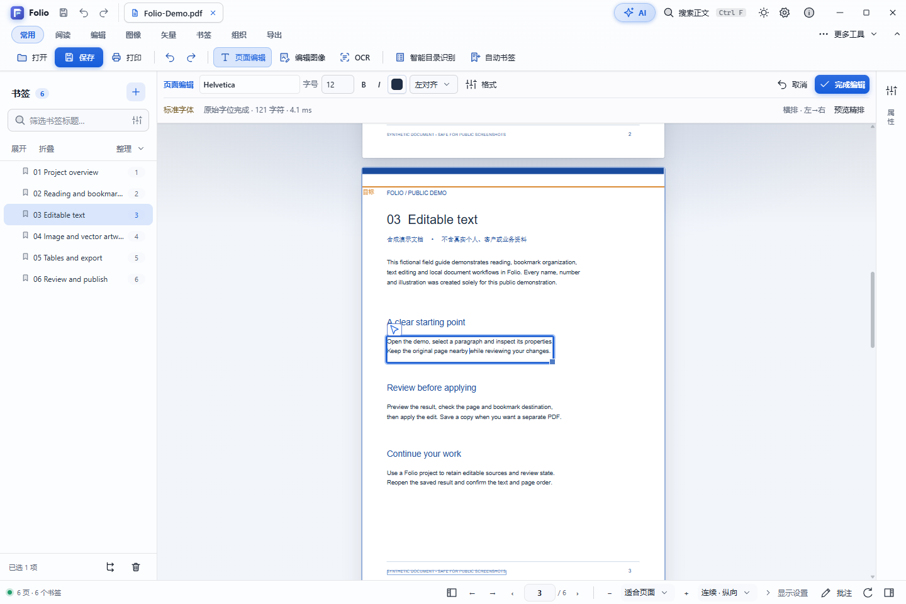

## 6. Inspect and choose fonts

Use the font workbench to search document, bundled and system fonts and inspect a sample. A matching name is not a guarantee of identical glyphs or coverage. Review the actual edited page before saving.

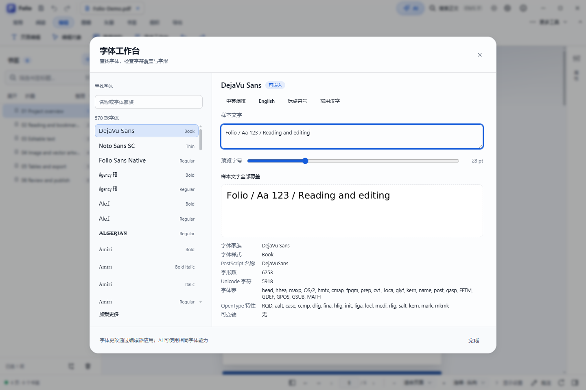

## 7. Edit image artwork

Choose an image under **Image → Image studio**. The generated landscape is a real image object opened in the embedded raster editor. Tools operate on the same canvas used by `folio_studio`. **Apply to PDF** writes an undoable document edit; save `.folio` to keep editable sources and layers.

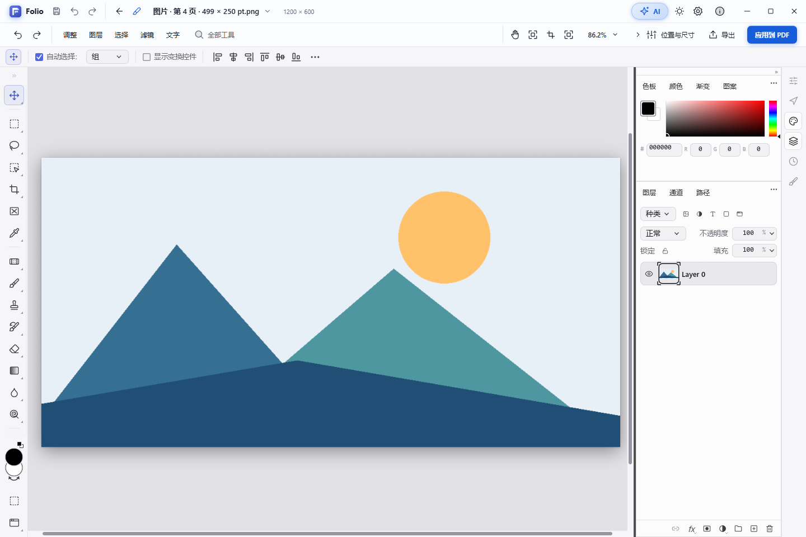

## 8. Create vector artwork

Choose **Vector → Vector studio** to create or edit artwork. This demonstration creates three rectangles, gradients and text using real local studio commands. The screenshot is actual editor output, not an AI-generated mockup or model response. Apply to the PDF and preserve source layers in a `.folio` project.

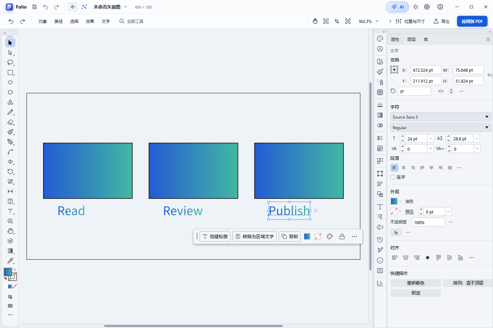

## 9. Recognize and review a scan locally

Open the synthetic scan, choose **OCR**, run recognition, then use the review tab to compare recognized text and page regions. These are real local OCR results. Confirm corrections before applying a searchable text layer and saving. OCR can miss text; confidence alone does not prove completeness.

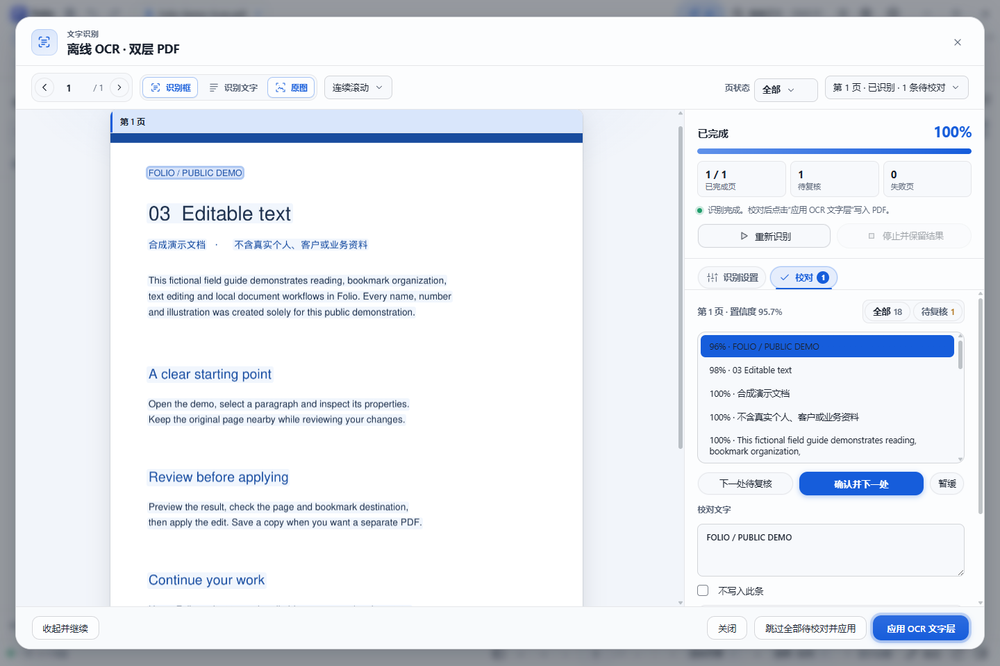

## 10. Export to Word and Excel

Choose **Export → Word / Excel**. Local processing is selected by default. Check the output file, reading order, tables and pagination; source evidence coverage is not a visual fidelity score. Scanned pages may need OCR first.

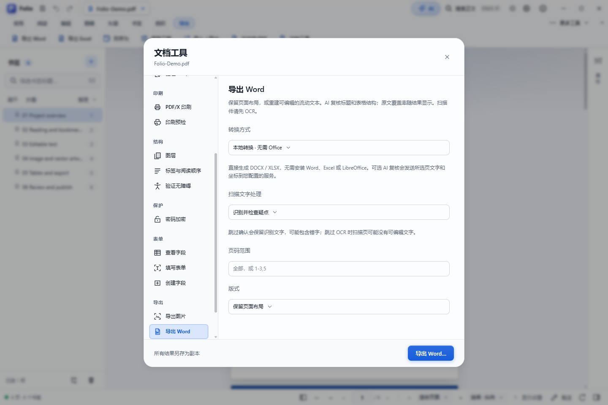

## 11. Preview printing

Open **Print**, select page range and layout, and inspect the preview before sending anything to a printer. Booklet and handout layouts support page arrangement. This screenshot only opens the preview; no print job was submitted.

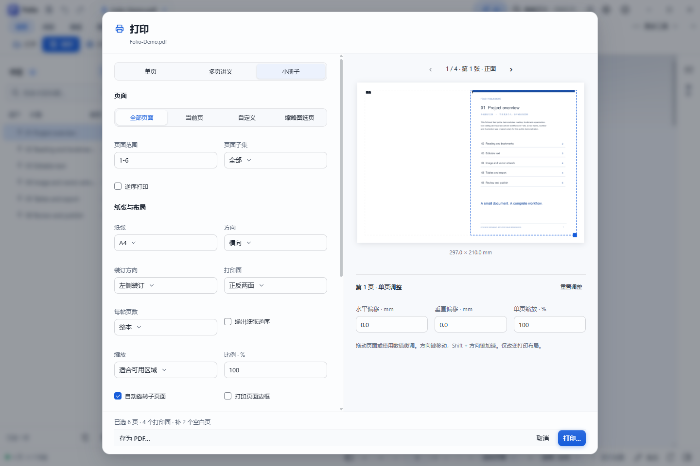

## 12. Set appearance and reading preferences

Open **Preferences** for language, theme, bookmarks, reading and saving. Version 2.8.3 makes checked states visible under focus, validates numeric fields and avoids unnecessary document refreshes when nothing changed.

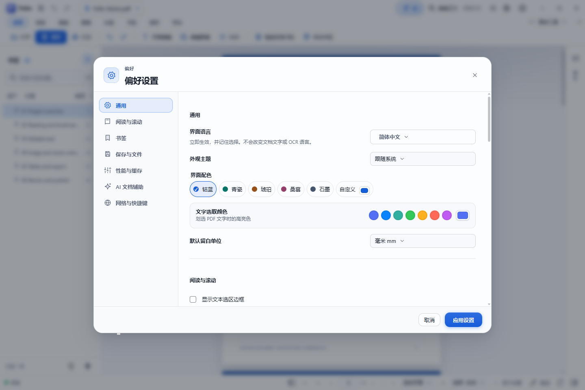

## 13. Read in a dark theme

Choose dark appearance while keeping the document artwork unchanged. The same synthetic PDF is shown here. Appearance preferences affect application chrome, not the PDF contents.

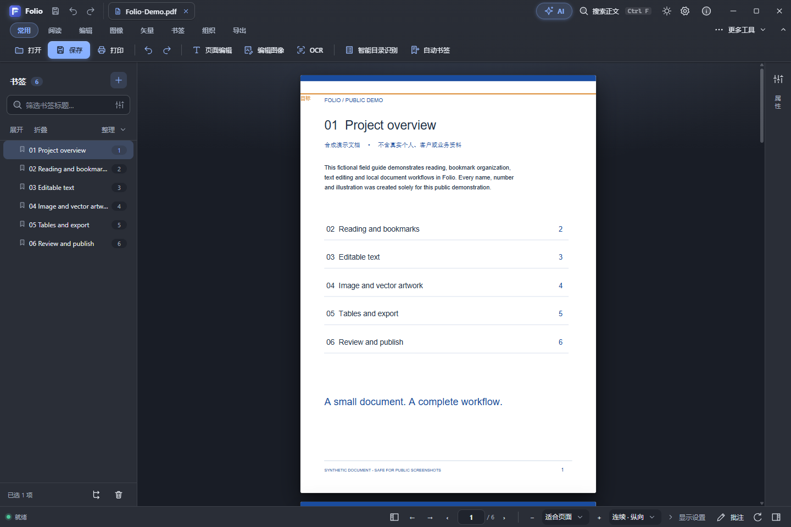

## AI assistance and saving

The **AI** button opens Chatbox for questions, cross-document comparisons and tool-assisted editing. Configure a tool-capable model; a vision model is needed to inspect pixels, and image generation has its own provider configuration. Requests may send required document text or images to that provider. This gallery does not send model requests or fabricate conversation screenshots. [AI guide](AI.en.md).

Apply edits before saving PDF. Original-file protection prompts for a copy on the first save; when disabled, eligible saves can append incrementally after verifying the file baseline. Save `.folio` for continued work on editable artwork and review state. Ordinary editing and projects retaining the original content are not secure redaction.
