# Folio 2.8.3 功能图解

[English](FEATURES.md) · [简体中文](FEATURES.zh-Hans.md) · [繁體中文](FEATURES.zh-Hant.md)

以下为 Windows 程序的实际界面截图，全部使用生成文档与独立的应用／Chatbox 配置，没有使用私有 PDF、个人最近文件、密钥或聊天记录。

[合成演示 PDF](examples/Folio-Demo.pdf) · [合成扫描 PDF](examples/Folio-Demo-Scan.pdf) · [素材来源与复现](SCREENSHOTS.md) · [完整使用指南](../README.zh-Hans.md)

图集展示当前界面和小型演示，不替代完整验收。发布验证与已知边界见[验证说明](VALIDATION.md)。

## 1. 阅读与定位

打开演示 PDF，通过书签树、页码框和底栏缩放定位；Ctrl+0 适合页面。多个文档分别保留自己的阅读位置和编辑状态。

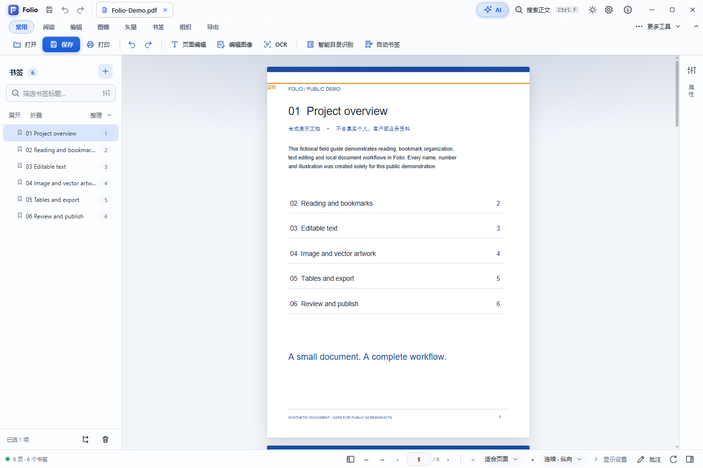

## 2. 规则生成书签

从「书签 → 自动书签」选择页范围、配置规则并复核命中标题。演示使用 `^0[1-6] +.+` 匹配生成的章节标题。应用长篇目录前，先检查重复项、层级与跳转目标。

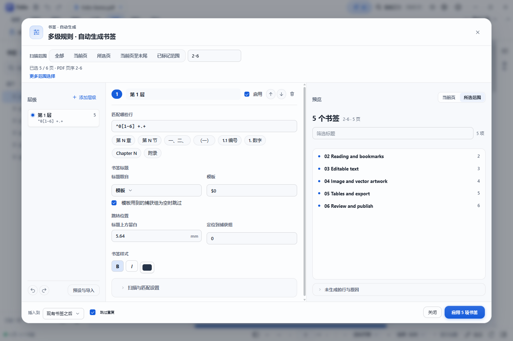

## 3. 书签质量检查

从「书签 → 统计 / QC」检查目录结构。目标校准用于核对标题证据，跳转留白用于调整落点，两者用途不同；统计结果不能代替对标题与页面的复核。

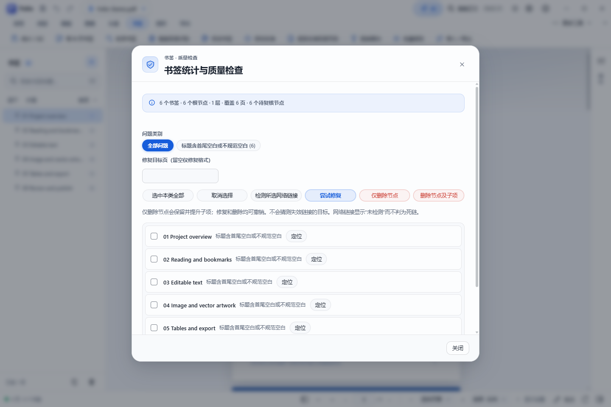

## 4. 可视化页面整理

从「组织 → 页面组织器」选择缩略图，通过键盘或拖动排序，空格预览，并可插入或旋转页面。核对结果后应用到当前文档再保存，或另存 PDF。组织器以当前已应用修改为基础。

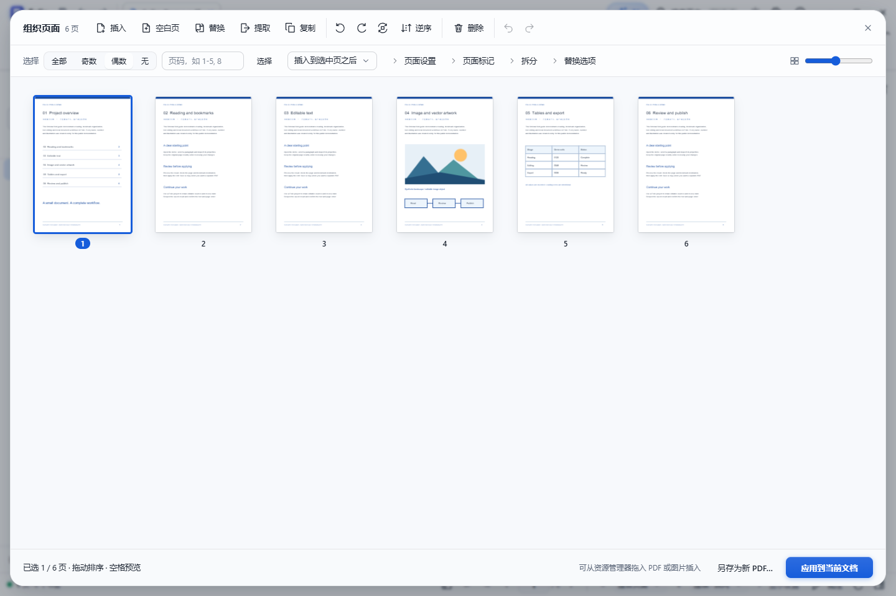

## 5. 页面内段落编辑

点击「页面编辑」，再选择可编辑段落。截图展示合成正文中的真实编辑状态。修改后核对字体替代、排版和溢出，完成编辑再保存；复杂布局或无法确认的编码可能需要替代方案或拒绝写回。

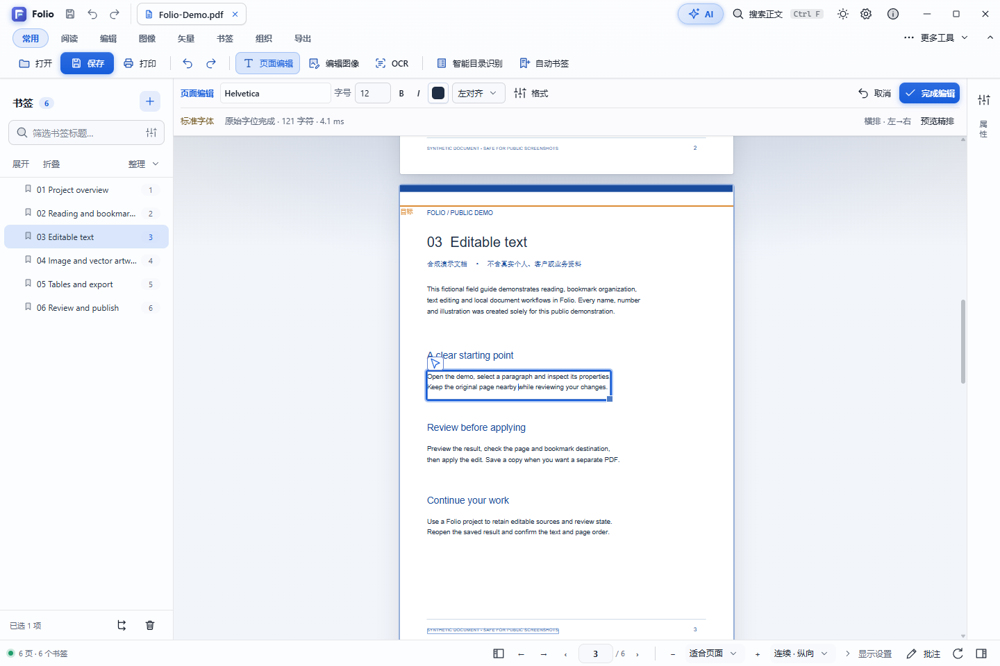

## 6. 字体工作台

在字体工作台中搜索文档、内置和系统字体并查看实际样例。字体名称相同不保证字形或覆盖完全一致，保存前仍需核对编辑页面。

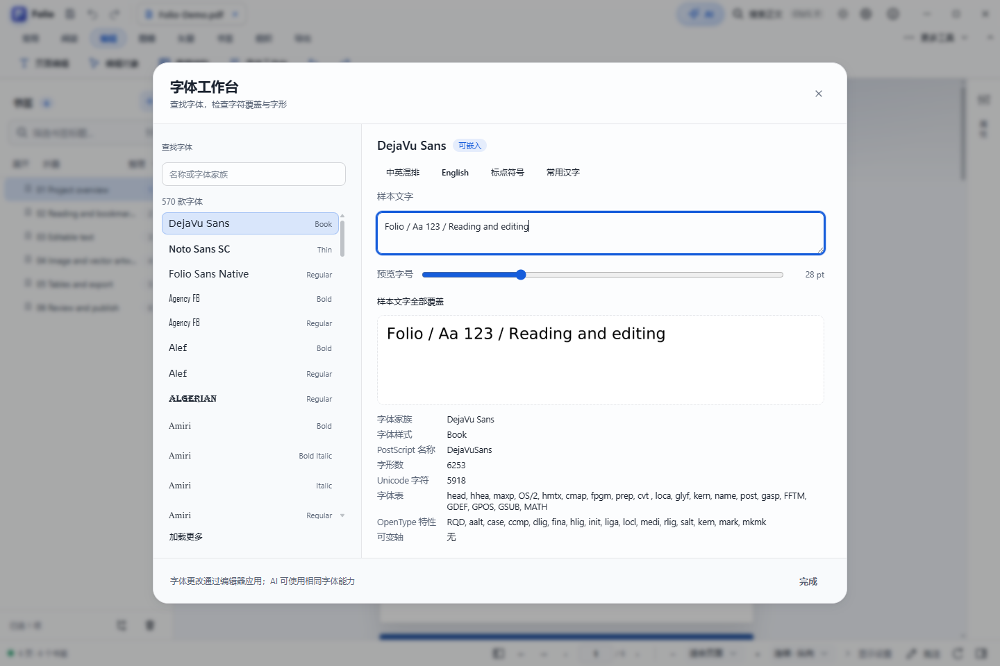

## 7. 图像工作室

在「图像 → 图像工作室」选择图片。合成山景作为真实图片对象载入嵌入式编辑器；人工与 `folio_studio` 使用同一画布。点击「应用到 PDF」产生可撤销的文档修改，需要保留可编辑源文件和图层时另存 `.folio` 工程。

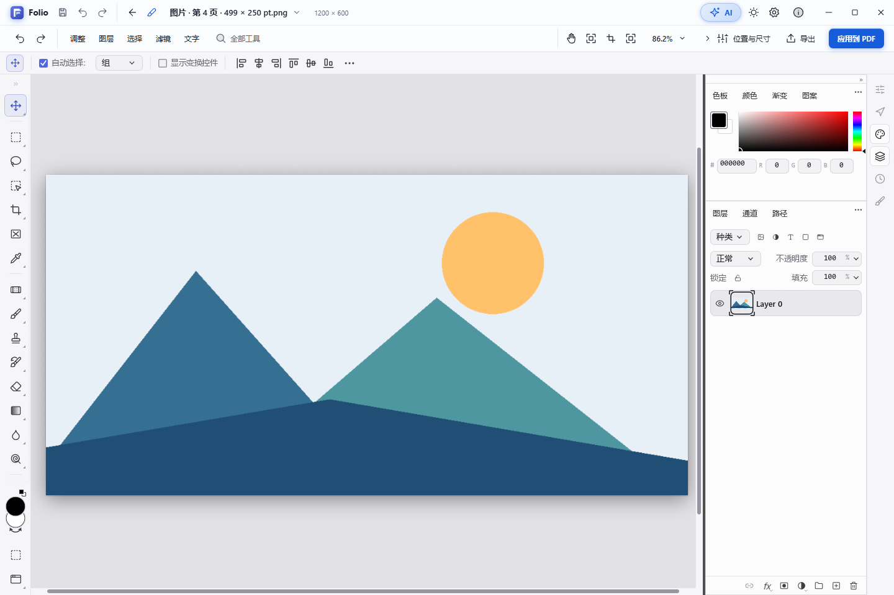

## 8. 矢量工作室

从「矢量 → 矢量工作室」创建或编辑作品。演示通过真实本地工具创建三个矩形、渐变与文字；截图来自实际编辑器，不是生成的界面效果图或模型回答。应用到 PDF，并用 `.folio` 工程保留源图层。

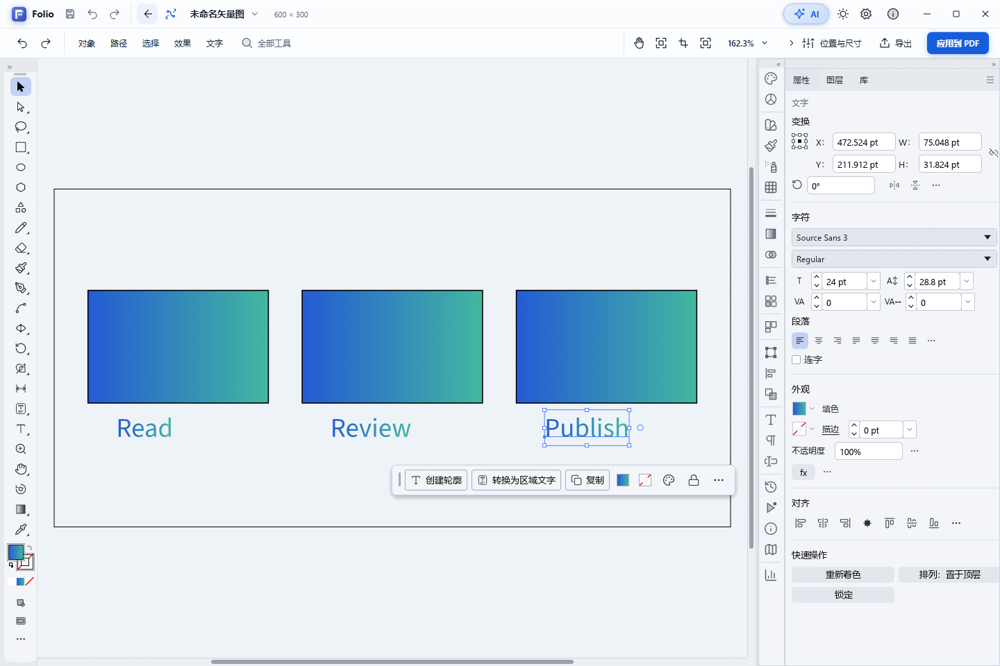

## 9. 本地 OCR 与逐项校对

打开合成扫描 PDF，点击「OCR」运行识别，在校对页中对照文字与页面区域。截图中的结果由本地 OCR 实际识别产生。逐项确认后应用可检索文字层并保存；置信度不能证明没有漏字。

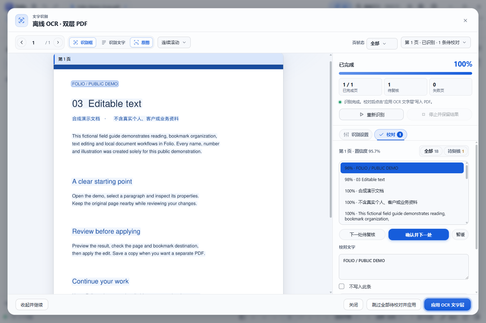

## 10. Word 与 Excel 导出

从「导出 → Word / Excel」进入，默认使用本地处理。导出后复核文件、阅读顺序、表格和分页；来源证据覆盖率不是版面保真分数。扫描件可能需要先完成 OCR。

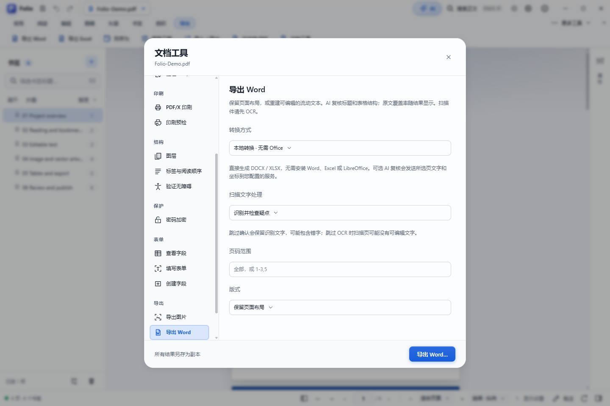

## 11. 打印预览

打开「打印」，选择范围与布局，先在预览中核对页序。小册子与讲义布局支持页面组合。本截图仅展示预览，没有向打印机提交任务。

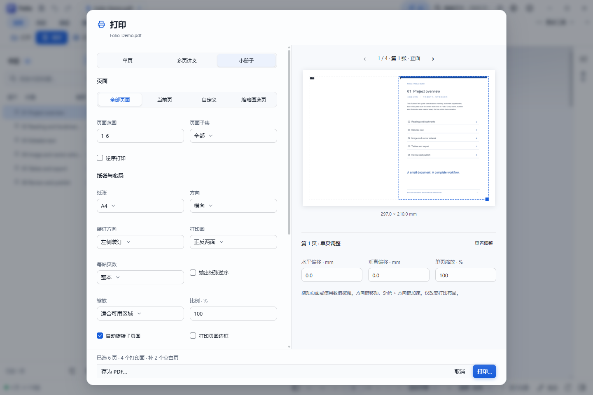

## 12. 外观与阅读设置

打开「首选项」调整语言、外观、书签、阅读和保存。2.8.3 保持焦点下选中状态清晰可见，校验数值输入，并避免未改变设置时刷新文档。

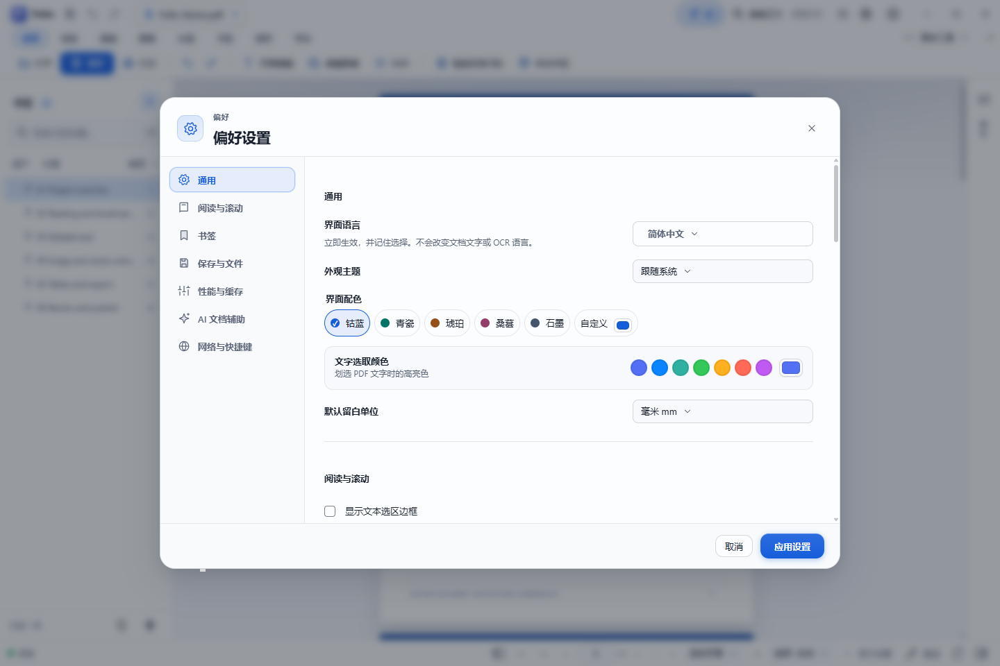

## 13. 深色阅读界面

选择深色外观，文档本身保持原样。此处仍为同一份合成 PDF；界面外观设置不会修改 PDF 内容。

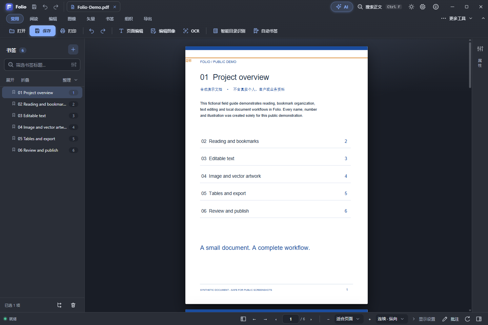

## AI 协助与保存

「AI」按钮打开 Chatbox，可提问、对照多份文档并调用编辑工具。配置支持工具调用的模型；查看像素需要视觉模型，生图另有独立服务商配置。请求可能把所需文字或图片发送给服务商。本图集不发送模型请求，也不伪造聊天截图。[AI 使用指南](AI.md)。

先应用编辑，再保存 PDF。原件保护默认首次另存副本；关闭保护后，符合条件的保存会先核对文件基线再增量追加。需要保留可编辑作品和校对状态时保存 `.folio` 工程。普通编辑与保留原始内容的工程不是安全涂黑。
