# Folio 2.8.4 功能圖解

[English](FEATURES.md) · [简体中文](FEATURES.zh-Hans.md) · [繁體中文](FEATURES.zh-Hant.md)

六張 2.8.4 截圖使用 Windows 上執行的發行版介面轉譯器和六頁示範 PDF。部分操作沿用舊版截圖，圖中保留擷取時的版本號。可點開原圖查看控制項。

[合成演示 PDF](examples/Folio-Demo.pdf) · [合成掃描 PDF](examples/Folio-Demo-Scan.pdf) · [素材來源與復現](SCREENSHOTS.zh-Hant.md) · [完整使用指南](../README.zh-Hant.md)

[段落編輯與儲存實測](VALIDATION-2.8.4.zh-Hant.md)

## 試用新的閱讀控制項

按 **Ctrl+Shift+P** 搜尋書籤命令。按 **Ctrl+F** 尋找 `Folio`，按一下結果便可跳至對應頁面。開啟右下角的檢視選單，可以切換暖紙等閱讀色調。

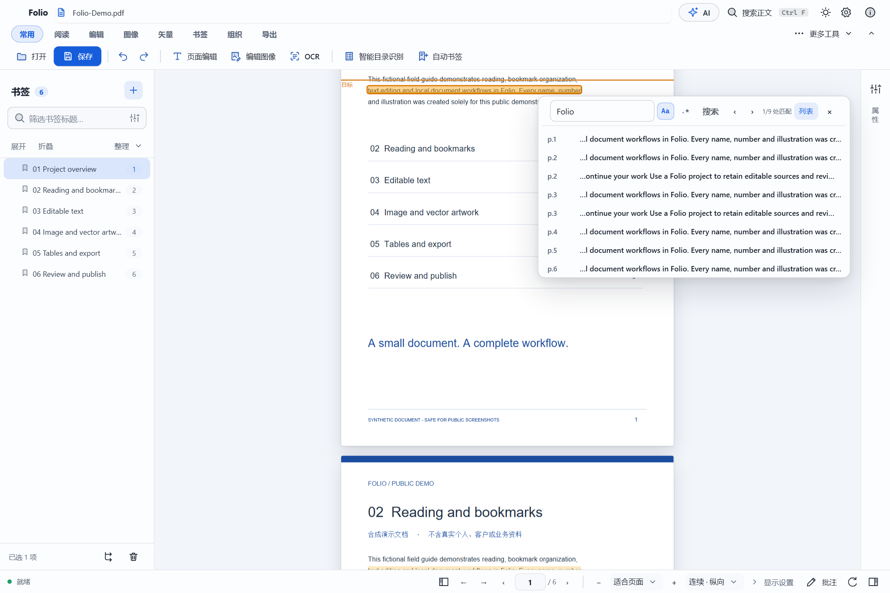

## 1. 閱讀與定位

開啟演示 PDF，通過書籤樹、頁碼框和底欄縮放定位；Ctrl+0 適合頁面。多個文件分別保留自己的閱讀位置和編輯狀態。

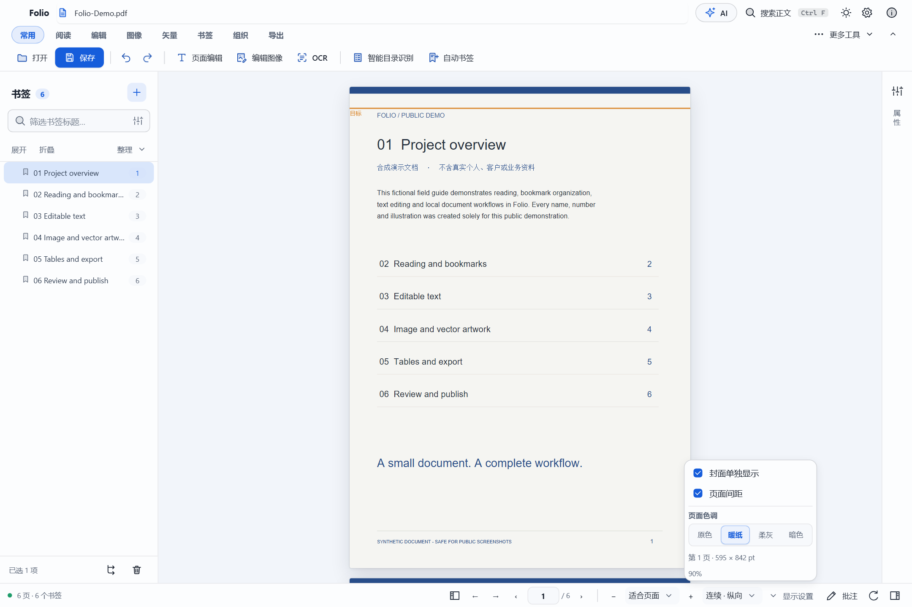

## 2. 規則生成書籤

從「書籤 → 自動書籤」選擇頁範圍、設定規則並複核命中標題。演示使用 `^0([1-6])\s+(.+)` 匹配生成的章節標題。應用長篇目錄前，先檢查重複項、層級與跳轉目標。

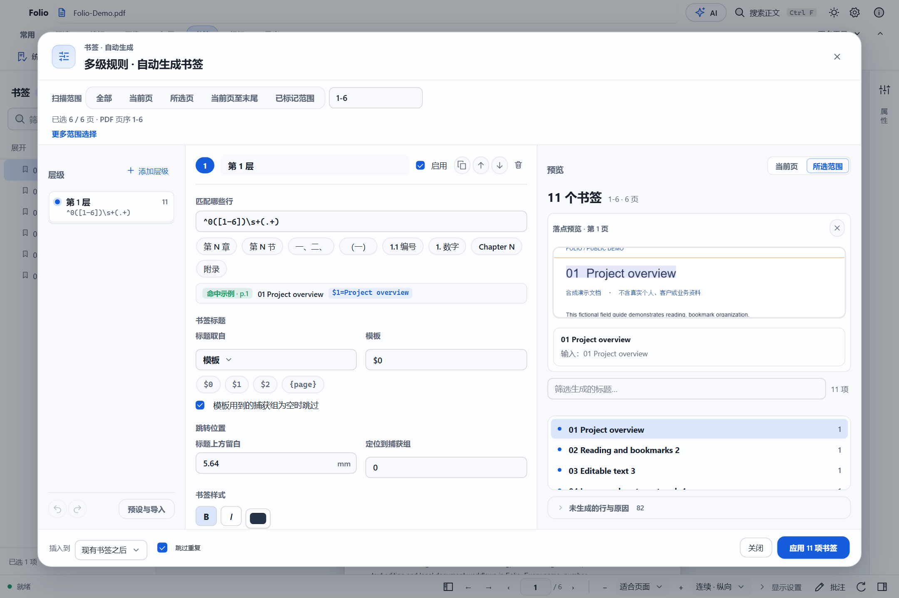

## 3. 書籤質量檢查

從「書籤 → 統計 / QC」檢查目錄結構。目標校準用於核對標題證據，跳轉留白用於調整落點，兩者用途不同；統計結果不能代替對標題與頁面的複核。

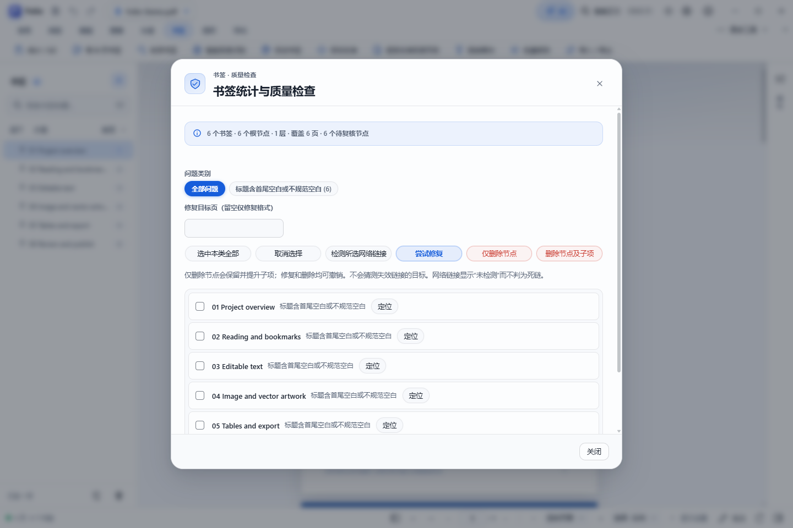

## 4. 可視化頁面整理

從「組織 → 頁面組織器」選擇縮略圖，通過鍵盤或拖動排序，空格預覽，並可插入或旋轉頁面。核對結果後應用到目前文件再儲存，或另存 PDF。組織器以目前已應用修改為基礎。

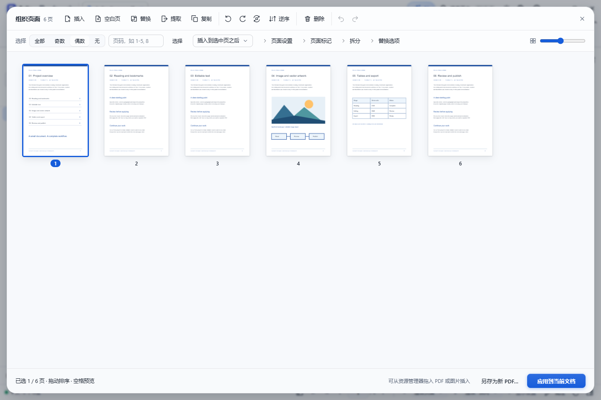

## 5. 頁面內段落編輯

點擊「頁面編輯」，再選擇可編輯段落。截圖展示合成正文中的真實編輯狀態。修改後核對字體替代、排版和溢出，完成編輯再儲存；複雜佈局或無法確認的編碼可能需要替代方案或拒絕寫回。

在示範文件第 3 頁選取段落，於原位置輸入。核對換行和字型後完成編輯，另存副本。段落中可按 **Ctrl+B** 切換粗體，按 **Ctrl+I** 切換斜體。

## 6. 字體工作臺

在字體工作臺中搜索文件、內置和系統字體並查看實際樣例。字體名稱相同不保證字形或覆蓋完全一致，儲存前仍需核對編輯頁面。

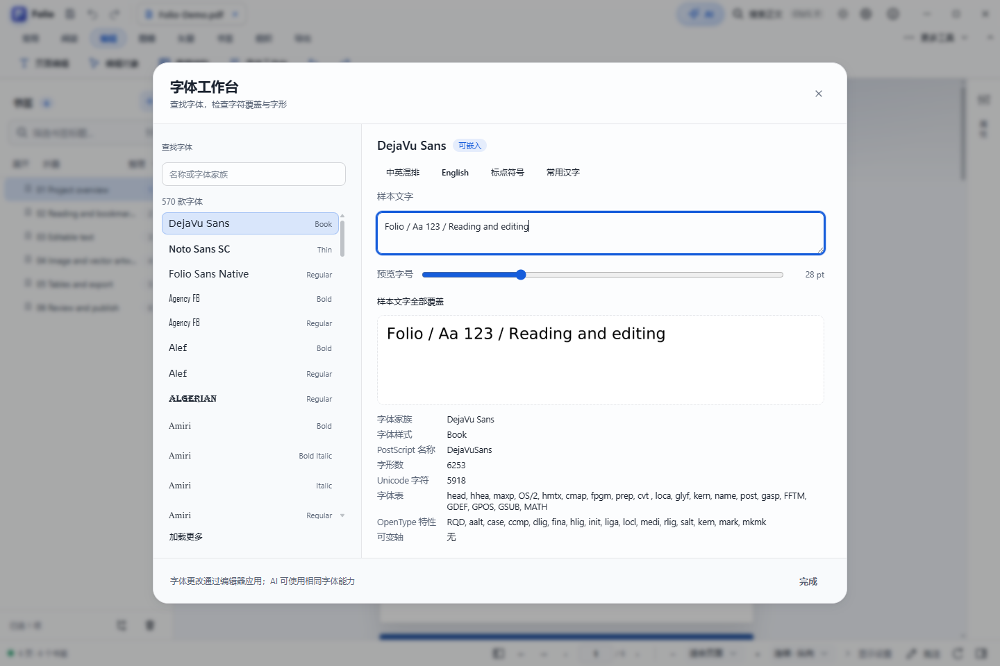

## 7. 圖像工作室

在「圖像 → 圖像工作室」選擇圖片。合成山景作為真實圖片對象載入嵌入式編輯器；人工與 `folio_studio` 使用同一畫布。點擊「應用到 PDF」產生可撤銷的文件修改，需要保留可編輯源文件和圖層時另存 `.folio` 工程。

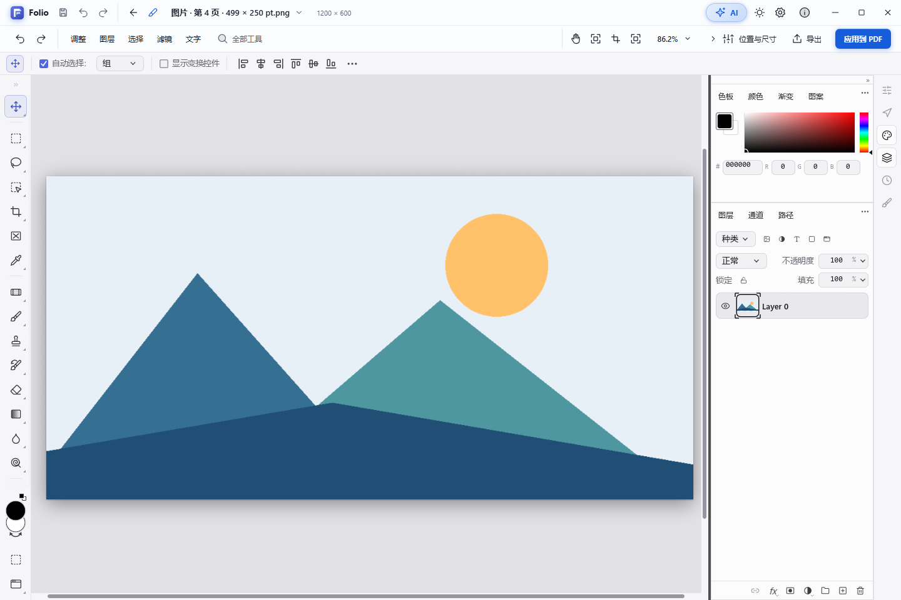

## 8. 向量工作室

從「向量 → 向量工作室」創建或編輯作品。演示通過真實本地工具創建三個矩形、漸變與文字；截圖來自實際編輯器，不是生成的介面效果圖或模型回答。應用到 PDF，並用 `.folio` 工程保留源圖層。

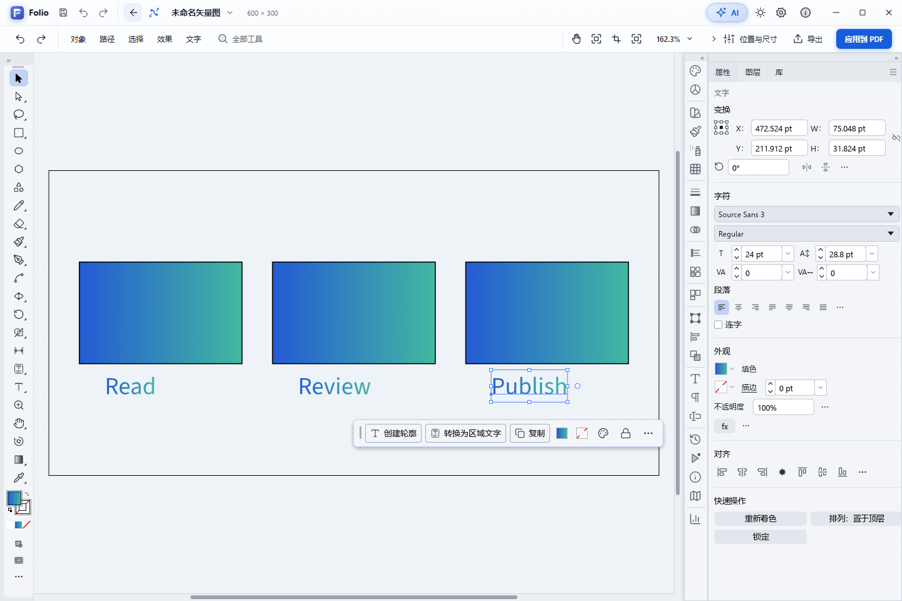

## 9. 本地 OCR 與逐項校對

開啟合成掃描 PDF，點擊「OCR」運行識別，在校對頁中對照文字與頁面區域。截圖中的結果由本地 OCR 實際識別產生。逐項確認後應用可檢索文字層並儲存；置信度不能證明沒有漏字。

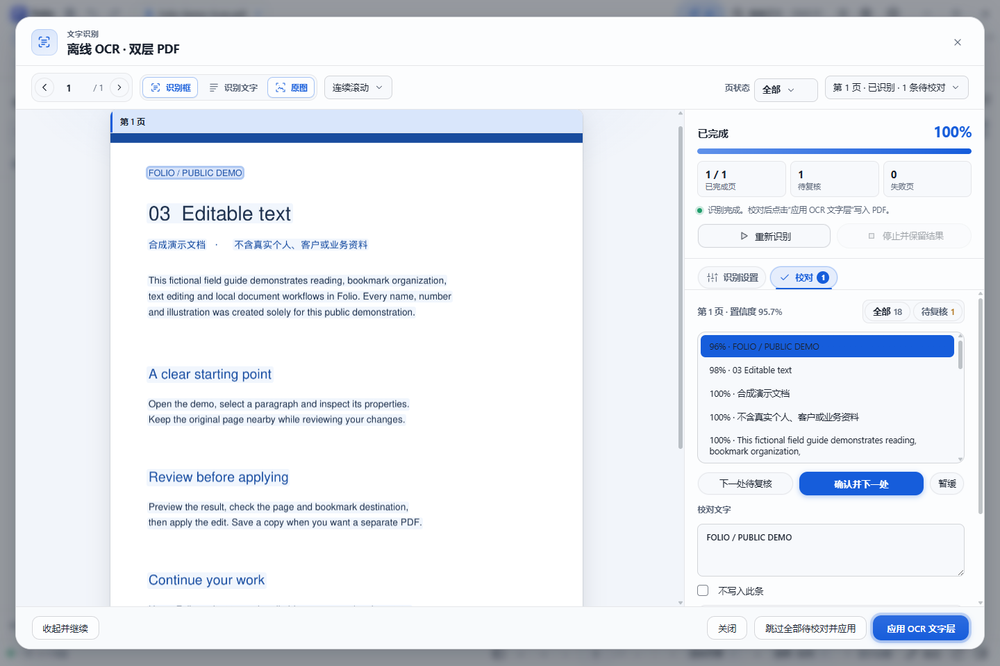

下圖用四筆預設資料示範如何選取區域、逐行校對。上圖保留了前一版引擎實際辨識示範掃描檔的結果。

## 10. Word 與 Excel 導出

從「導出 → Word / Excel」進入，預設使用本地處理。導出後複核文件、閱讀順序、表格和分頁；來源證據覆蓋率不是版面保真分數。掃描件可能需要先完成 OCR。

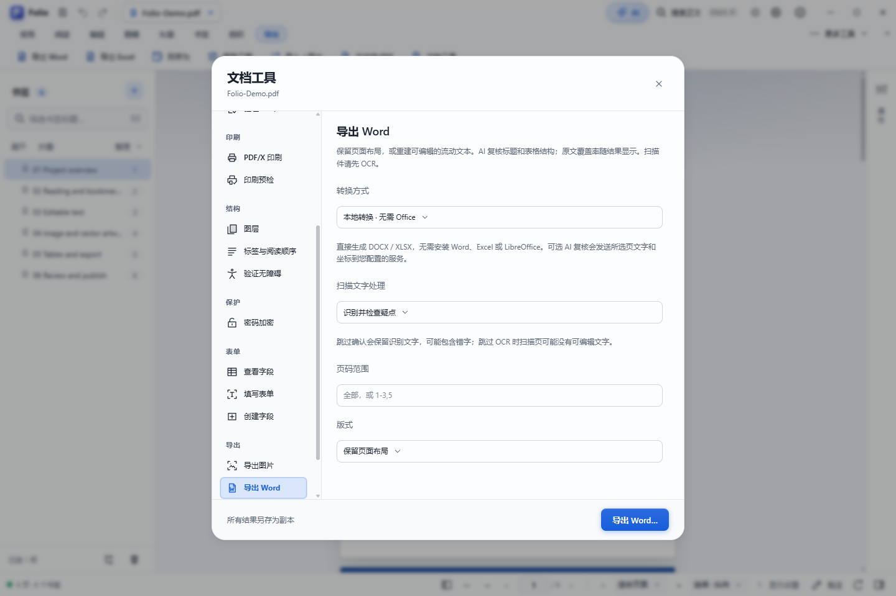

## 11. 打印預覽

開啟「打印」，選擇範圍與佈局，先在預覽中核對頁序。小冊子與講義佈局支持頁面組合。本截圖僅展示預覽，沒有向打印機提交任務。

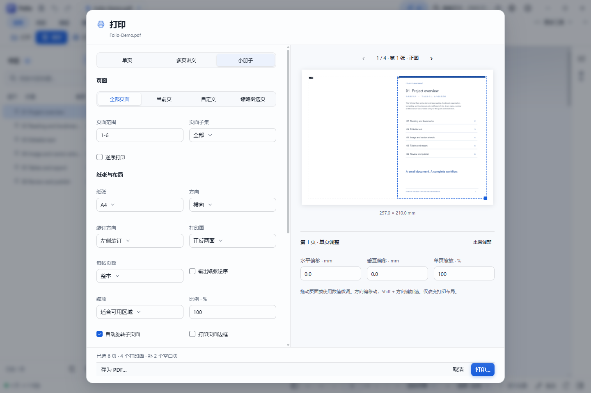

## 12. 外觀與閱讀設置

開啟「首選項」調整語言、外觀、書籤、閱讀和儲存。2.8.3 保持焦點下選中狀態清晰可見，校驗數值輸入，並避免未改變設置時刷新文件。

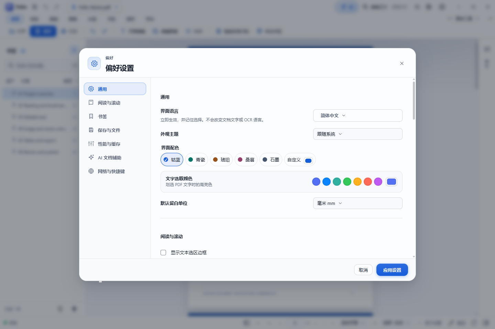

## 13. 深色閱讀介面

選擇深色外觀，文件本身保持原樣。此處仍為同一份合成 PDF；介面外觀設置不會修改 PDF 內容。

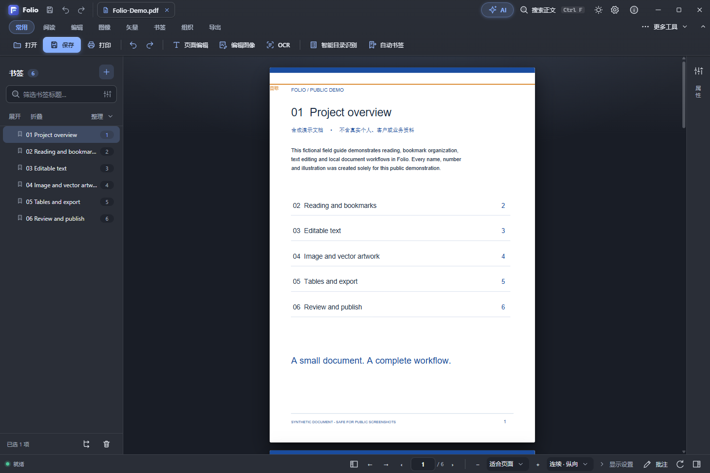

## AI 協助與儲存

「AI」按鈕開啟 Chatbox，可提問、對照多份文件並調用編輯工具。設定支持工具調用的模型；查看像素需要視覺模型，生圖另有獨立服務商設定。請求可能把所需文字或圖片發送給服務商。本圖集不發送模型請求，也不偽造聊天截圖。[AI 使用指南](AI.zh-Hant.md)。

先應用編輯，再儲存 PDF。原件保護預設首次另存副本；關閉保護後，符合條件的儲存會先核對文件基線再增量追加。需要保留可編輯作品和校對狀態時儲存 `.folio` 工程。普通編輯與保留原始內容的工程不是安全塗黑。
