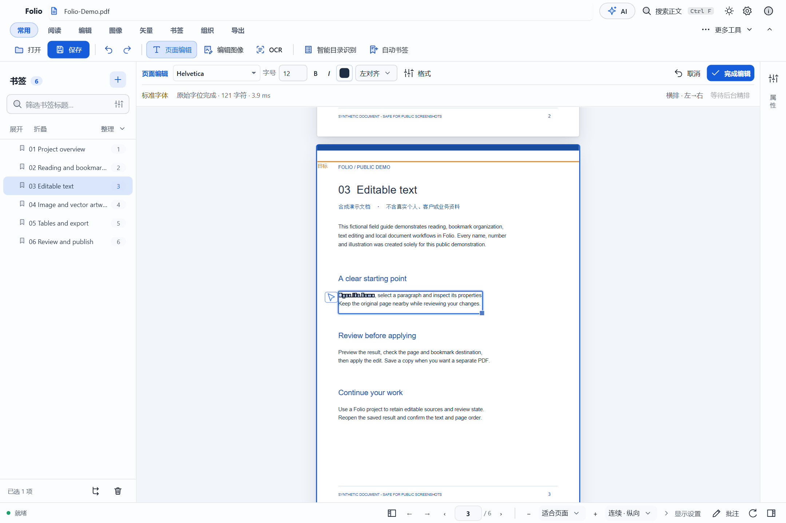

# Folio PDF Studio 2.8.6 documentation

Download the complete Windows x64 portable ZIP, or use **Check for updates** in Folio. The release also includes the source ZIP, checksums and the build’s validation report. [Folio 2.8.6 downloads](https://github.com/ionize1080/Folio/releases/tag/v2.8.6).

| Start here | English | 简体中文 | 繁體中文 |
| --- | --- | --- | --- |
| Installation, editing, saving and limitations | [User guide](../README.md) | [使用指南](../README.zh-Hans.md) | [使用指南](../README.zh-Hant.md) |
| Real interface screenshots and workflows | [Feature tour](FEATURES.md) | [功能图解](FEATURES.zh-Hans.md) | [功能圖解](FEATURES.zh-Hant.md) |
| Screenshot gallery and sample files | [Gallery](SCREENSHOTS.md) | [界面图库](SCREENSHOTS.zh-Hans.md) | [介面圖庫](SCREENSHOTS.zh-Hant.md) |
| 2.8.4 paragraph timings and Reader XI validation | [Results](VALIDATION-2.8.4.md) | [测试结果](VALIDATION-2.8.4.zh-Hans.md) | [測試結果](VALIDATION-2.8.4.zh-Hant.md) |
| AI reading, artwork and document tools | [Chatbox and MCP](AI.en.md) | [Chatbox 与 MCP](AI.md) | [Chatbox 與 MCP](AI.zh-Hant.md) |
| Changes in the current release | [Release notes](RELEASE-2.8.6.md) | [发布说明](RELEASE-2.8.6.zh-Hans.md) | [發行說明](RELEASE-2.8.6.zh-Hant.md) |

## Find a tool and edit a paragraph

Press **Ctrl+Shift+P** and enter a keyword to find a command. Open a PDF with selectable text, enter paragraph editing, then select the passage on the page. After applying the edit, save a copy and reopen it to inspect the result. For a scan, the OCR workspace can add a searchable text layer. [Editing and OCR](FEATURES.md) · [Save compatibility and measured timings](VALIDATION.md)

## Task and engineering guides

| Task | Reference |
| --- | --- |
| Try the application without private documents | [Synthetic PDF](examples/Folio-Demo.pdf) · [Synthetic scan](examples/Folio-Demo-Scan.pdf) · [Screenshot provenance](SCREENSHOTS.md) |
| Edit images and vectors, keep layers and use the PDF as a reference | [Artwork workspace](CREATIVE-STUDIO.md) |
| Match bookmark destinations to heading evidence | [TOC page calibration](TOC-PAGE-CALIBRATION.md) |
| Understand tabs, revisions, previews and saving | [Architecture](ARCHITECTURE.md) |
| Build, test and package | [Development](DEVELOPMENT.md) · [CI architecture](ci-architecture.md) · [Current release workflow](../.github/workflows/release-284.yml) |
| Change appearance or contribute translations | [Desktop design](DESIGN.md) · [Localization](LOCALIZATION.md) |
| Check what was tested | [Validation](VALIDATION.md) · [2.8.3 UI audit](UI-AUDIT-2026-11-16.zh-Hans.md) |
| Review license obligations | [Folio license](../LICENSE) · [Third-party notices](../THIRD-PARTY-NOTICES.md) |

## Historical records

[Complete archive by filename](HISTORY.md) lists older release notes, plans, audits and versioned technical records. Their measurements and instructions apply to the named build; they are not the current setup guide. Historical content is retained with an archive notice and a link back here.

Recent milestones include [2.8.3 preference and reading controls](RELEASE-2.8.3.md), [2.8.2 bookmark precision](RELEASE-2.8.2.md), [2.8.1 saving](RELEASE-2.8.1.md), [2.8.0 interface](RELEASE-2.8.0.md), [2.7.0 document workflows](RELEASE-2.7.0.md).
