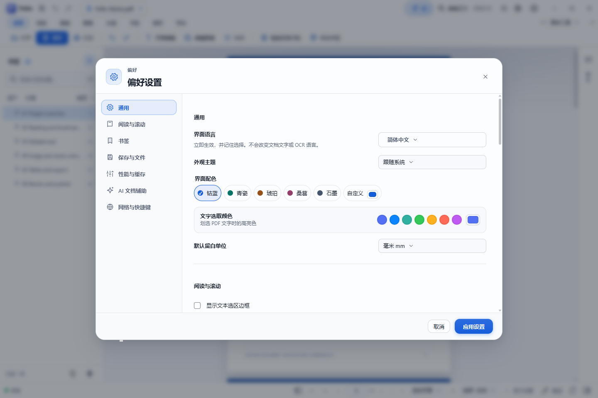

# Folio PDF Studio 2.8.3

修复设置选项“点击后仍未选中”的显示问题。选中状态实际已改变，但通用焦点样式覆盖了复选框底色，白色勾号因此不可见。现在鼠标点击、点击文字及空格切换后，明暗主题都能清楚显示选中状态；OCR 和阅读设置中的复选框也恢复正确的正方形尺寸。

设置应用前检查必填数值、范围和整数，防止重复提交。设置未变化时不刷新 PDF，也不重复写入设备配置。书签定位线的显示开关和颜色立即生效。小窗口中的偏好、OCR 和规则编辑区更易操作；搜索支持 Esc 关闭并恢复焦点。

本地验证覆盖七类设置、十个复选框、23 个下拉选项、十二种主题配色、58 个面板状态、九种缩放及五种阅读布局。性能检查涵盖一万个书签、24 次工具栏切换、滚动、缩放和反复开关对话框。未改变设置时 PDF 刷新次数为零；耗时作为实测记录，不代表所有设备的速度保证。首次打开面板和初始化编辑仍存在短暂长任务。完整范围及限制见[排查报告](UI-AUDIT-2026-11-16.zh-Hans.md)。

GitHub Actions 重新构建完整 Windows 程序，并行执行已有的原生引擎、编辑、保存完整性、AI、更新器检查和新增 UI 检查。最终便携 ZIP 须在六组并行任务中通过 38 个验收脚本后才发布。附件提供源码、绑定提交的验收证据和 SHA-256 校验值。CI 使用生成或公开样本，不上传用户私人文档。

[当前使用指南](../README.zh-Hans.md) · [功能与实际截图](FEATURES.zh-Hans.md) · [下载与校验值](https://github.com/ionize1080/Folio/releases/tag/v2.8.3)

