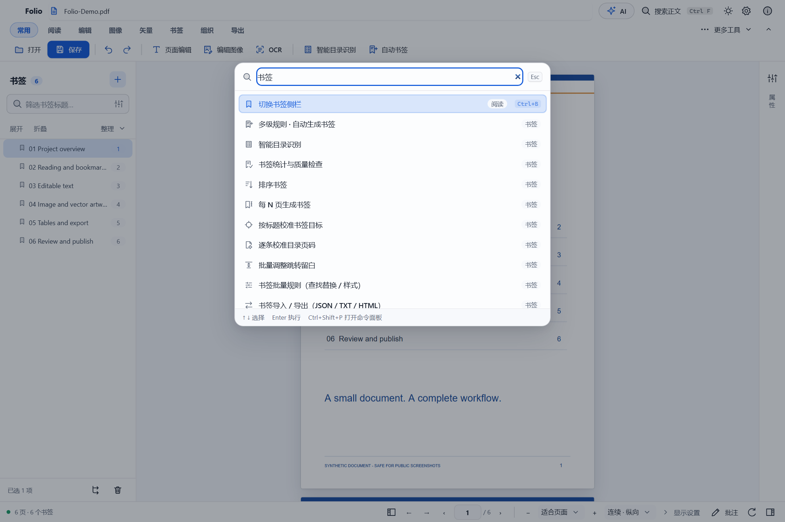

# Folio PDF Studio 2.8.4

[English](RELEASE-2.8.4.md) · [简体中文](RELEASE-2.8.4.zh-Hans.md) · [繁體中文](RELEASE-2.8.4.zh-Hant.md)

在支援的橫排段落中，點選後即可開始輸入，Folio 會同時準備編輯底圖。新版也解決了 Adobe Reader XI 開啟部分增量儲存檔案時出現錯誤 14 的問題。[Windows x64 可攜版與原始碼下載](https://github.com/ionize1080/Folio/releases/tag/v2.8.4)

## 在原位置編輯段落

開啟含文字的 PDF，進入段落編輯後點選一段橫排內文。準備底圖與字型期間即可輸入或復原，以 **Ctrl+B** 與 **Ctrl+I** 切換粗體與斜體。返回已分析的頁面會重用解析結果。原生程序也會重用字型名稱索引，字型檔案變動時才會更新。

在恆隆中期報告的本機對照中，兩處帶標籤段落準備底圖的耗時分別從 1.468 秒與 2.094 秒降至 **0.420 秒與 0.939 秒**。首次進入編輯模式、套用需要補充字形的修改仍可能耗時數秒。[耗時與保真比對記錄](https://github.com/ionize1080/Folio/pull/26)

在第 23 頁的一次獨立本機編輯中，輸入替換文字耗時 4.1 毫秒，套用修改耗時 12.85 秒，增量儲存耗時 3.47 秒。[六個階段的實測時間](VALIDATION-2.8.4.zh-Hant.md)

## 尋找命令與閱讀工具

按 **Ctrl+Shift+P**，輸入部分命令名稱即可搜尋。書籤與 OCR 工作區更新了控制項，搜尋結果集中顯示，閱讀檢視可更換紙張色調。啟用還原閱讀位置後，開啟 PDF 時也會略過多餘的開啟動作查詢。

[功能圖解](FEATURES.zh-Hant.md) · [配圖來源](SCREENSHOTS.zh-Hant.md)

## 在 Adobe Reader XI 開啟增量儲存的檔案

Folio 保留原始交叉參照格式、文件識別碼與尾端字典項目，包括線性化 PDF 首個尾端字典中的中繼資料。對同一份含交叉參照串流的樣本，2.8.3 連續兩次增量儲存，都讓 Reader XI 11.0.10.32 回報錯誤 14。2.8.4 連續兩次儲存均可開啟，也能複製兩頁的預期文字。在 2.8.4 開啟此案例中已出錯的舊版副本，再進行一次增量儲存，也恢復了可讀性，並完整保留先前修訂的位元組。[錯誤 14 重現與修復記錄](https://github.com/ionize1080/Folio/actions/runs/44871005460/job/136745299657)

另外使用 Reader XI 逐份冷啟動開啟 12 份公開測試 PDF，全數可翻到末頁。樣本涵蓋傳統交叉參照表、線性化 PDF、連續儲存與段落編輯。首次儲存、二次儲存及重做後的副本均可複製出預期中文。[Reader XI 實測記錄](https://github.com/ionize1080/Folio/actions/runs/44870462512/job/136743594117)

## 核對儲存後的內容

群暉 DS1621+ 中文規格書編輯後，重新開啟即可搜尋到新文字，旁欄、上標註腳與其餘七頁的算繪比對一致。雙欄 NAACL 論文的摘要僅增加 `Test.`，擷取順序與原文一致。對多行共用文字物件的無標籤段落，若能重建文字位置與狀態，Folio 會保留其閱讀順序。

七份 PDF 的書籤增量儲存通過 qpdf 檢查。MuPDF 比對全部 305 頁的文字、幾何尺寸及 0.32 倍算繪，PDFium 另以 0.5 倍算繪比對 19 個抽樣頁面，結果均一致。Windows 發行附件提供本次驗收的可攜 ZIP、原始碼 ZIP、驗證 JSON 與 SHA-256 清單。[2.8.4 驗證範圍](VALIDATION-2.8.4.zh-Hant.md) · [Windows 發行工作流程](https://github.com/ionize1080/Folio/actions/workflows/release-284.yml)
