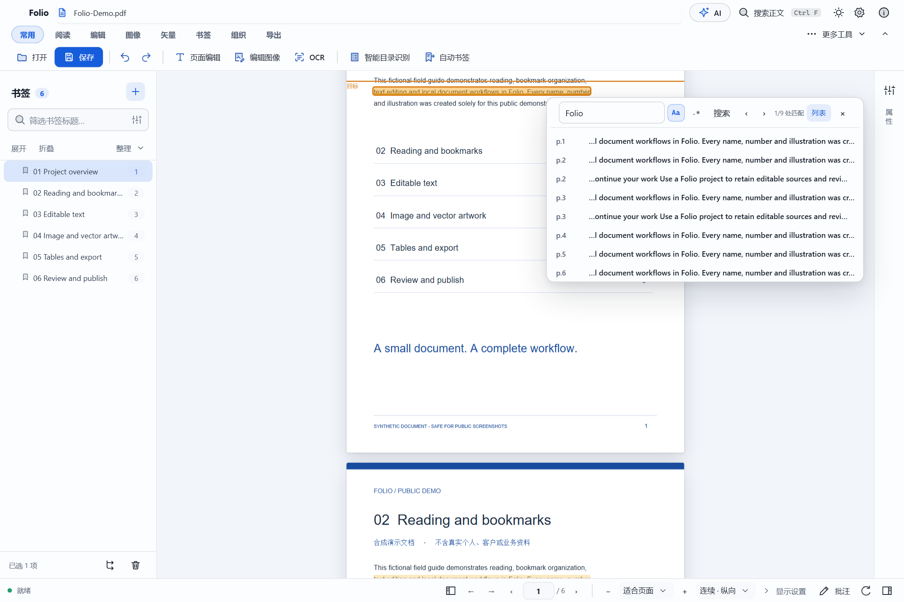
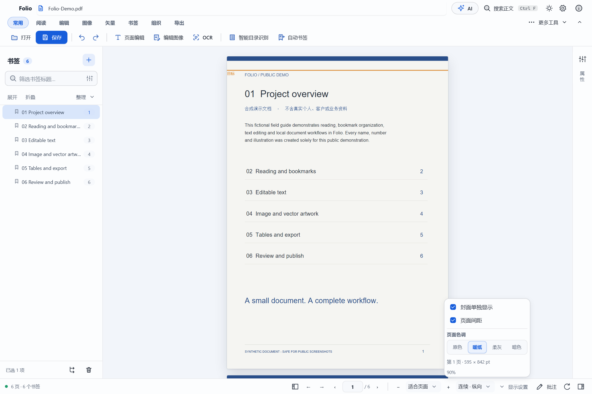
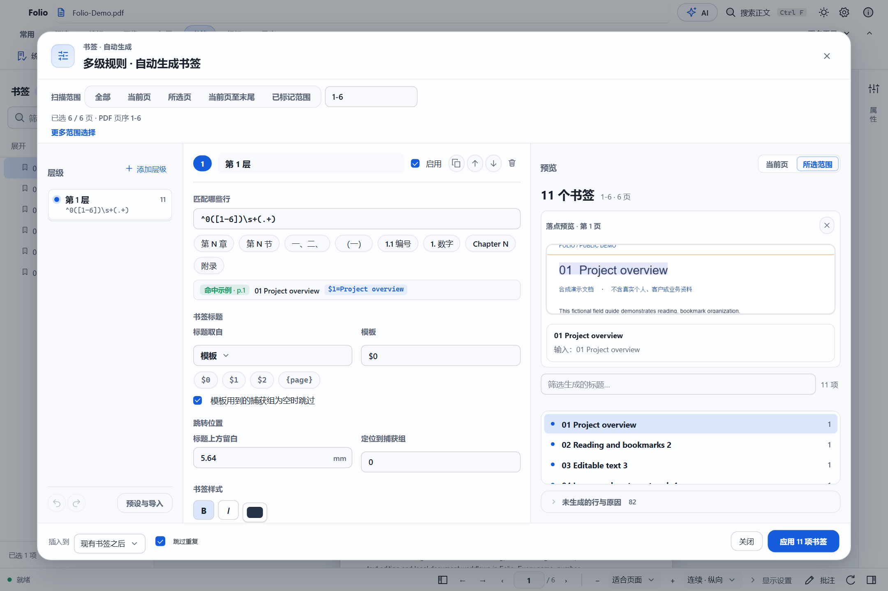
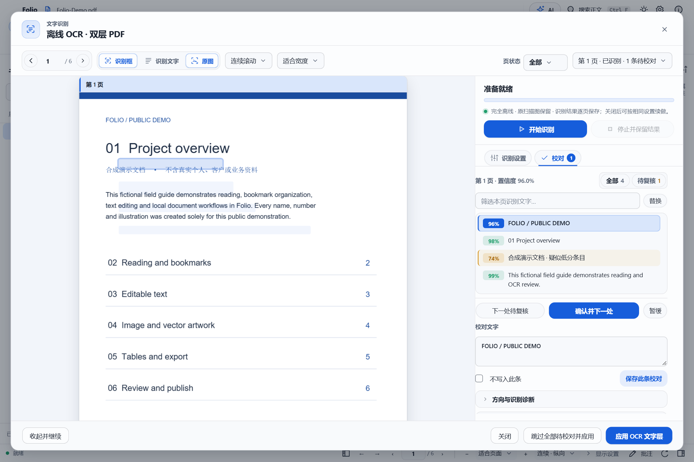

# Folio 2.8.4 in screenshots

[English](SCREENSHOTS.md) · [简体中文](SCREENSHOTS.zh-Hans.md) · [繁體中文](SCREENSHOTS.zh-Hant.md)

Open the six-page [Folio demo PDF](examples/Folio-Demo.pdf) to follow along. The screenshots show the Folio 2.8.4 renderer running on Windows in a Chromium test session, using Simplified Chinese controls. Select an image to see the full-size controls.

[User guide](../README.md) · [Full feature tour](FEATURES.md) · [Release notes](RELEASE-2.8.4.md)

## Find a command

Press **Ctrl+Shift+P** and enter `书签` (bookmarks). Use the arrow keys to choose a command and **Enter** to run it. **Esc** closes the palette and returns you to the document.


## Jump to a match

Press **Ctrl+F**, search for `Folio` and open the results list. Each row includes the page and surrounding words. Select a row to jump directly to that passage. Here the first of nine hits is highlighted on the page.



## Edit text where it sits

Open page 3, enter page text editing and click an editable paragraph. Type in the active text box, finish the edit, then save the PDF. Reopen the saved copy and search for the replacement to check it. The image shows the editing step.


## Choose a reading tone

Open the view options at the lower right and choose a page tone. The warm setting shown here changes the page display. Select the original paper tone again to compare it with the source colors.



## Preview a bookmark destination

Open **Bookmarks → Automatic bookmarks**. Try `^0([1-6])\s+(.+)` on pages 1–6. Select a match in the preview and inspect its destination before applying the rules. The demo produces eleven matches because the contents entries and chapter headings can both match.



## Review OCR text against the page

Open the OCR review tab and select a row to locate its region on the page. Compare the text, correct it if necessary and confirm it before applying the text layer. This capture uses four preset entries to demonstrate selection and confidence indicators. The [2.8.3 recognition capture](images/2.8.3/13-ocr-review.png) shows actual local engine output on the [demo scan](examples/Folio-Demo-Scan.pdf).



## Where the images came from

Five of the walkthroughs also run in the [2.8.4 desktop UI test](../tests/ui-polish-284.cjs). From a prepared Windows checkout, point `FOLIO_EXE` to the candidate executable, set `FOLIO_AUDIT_OUT` to an output directory and run `node tests/ui-polish-284.cjs`. The audit opens the demo in an isolated profile and captures the command palette, search results, reading tone, bookmark rules and OCR review.

The public fixture generator creates the text, numbers, bookmarks, table and illustration from scratch. The 2.8.4 screenshots use this material. The image manifest gives the exact dimensions and SHA-256 of each published WebP. For saved-file rendering comparisons, Reader XI checks and timings, see the release validation.

[Fixture generator](../scripts/docs-fixtures.py) · [2.8.4 image manifest](images/2.8.4/manifest.json) · [Release validation](VALIDATION-2.8.4.md)

## Reproduce the archived 2.8.3 captures

The archived gallery uses the Windows application at commit `fe5b6a7b52350e908da9009142bb68129f7f09c2`. Its 13 PNGs use a 1440 × 960 viewport at scale factor 1, reduced motion and isolated Folio and Chatbox profiles. The image and vector studios show edits made with local tools. The Word export and print views show the settings before execution. The OCR capture was taken after a local recognition run returned text.

In a separate checkout of documentation commit `99527c9`, prepare the native runtime, OCR models and embedded editors. Run these commands from that checkout.

```powershell
native/runtime/python.exe scripts/docs-fixtures.py
node scripts/docs-screenshots.cjs
node scripts/check-docs.mjs
```

The archive capture script writes to `docs/images/2.8.3/`. Profiles are created under `tests/output/`. Use `node scripts/docs-screenshots-detail.cjs` for the detailed capture set. After a visual review, refresh the archive manifest with the repository's checker for that revision. Its hashes cover 13 PNGs and both generated PDFs.

[Build instructions](DEVELOPMENT.md) · [2.8.3 manifest](images/2.8.3/manifest.json) · [Archive capture script at the documentation revision](https://github.com/ionize1080/Folio/blob/99527c9e0e68166489064a63814f454341b5c798/scripts/docs-screenshots.cjs)
