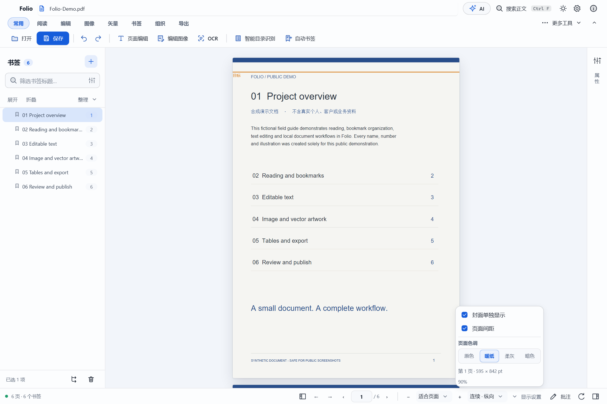
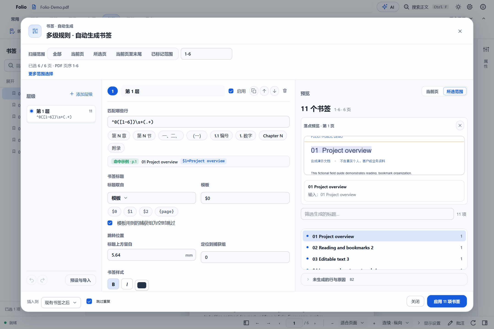

# Folio 2.8.4 实际界面图解

[English](SCREENSHOTS.md) · [简体中文](SCREENSHOTS.zh-Hans.md) · [繁體中文](SCREENSHOTS.zh-Hant.md)

打开六页的 [Folio 演示 PDF](examples/Folio-Demo.pdf)，即可跟着下面的步骤试用。截图来自 Windows 上运行的 Folio 2.8.4 界面渲染代码，采集环境为 Chromium 测试会话，使用简体中文界面。点击图片可查看原图。

[使用指南](../README.zh-Hans.md) · [完整功能图解](FEATURES.zh-Hans.md) · [发布说明](RELEASE-2.8.4.zh-Hans.md)

## 用键盘找命令

按 **Ctrl+Shift+P**，输入“书签”。用方向键选择命令，按 **Enter** 执行。按 **Esc** 可收起面板，返回当前文档。


## 直接跳到搜索结果

按 **Ctrl+F** 搜索 `Folio`，展开结果列表。每行列出页码和命中位置前后的文字，点击即可跳到对应段落。图中共有九处匹配，页面高亮显示第一处。


## 在原位置编辑段落

翻到第 3 页，进入页面文字编辑，点击一个可编辑段落。在激活的文本框内输入，完成编辑，再保存 PDF。重新打开副本后，可搜索替换后的文字进行核对。截图展示的是输入阶段。


## 切换阅读色调

打开右下角的视图选项，选择页面色调。图中已选“暖纸”，适合对照查看纸面色彩变化。切回原色即可查看文档本来的配色。



## 查看书签实际跳转到哪里

打开“书签 → 多级规则·自动生成书签”，在第 1–6 页试用 `^0([1-6])\s+(.+)`。点选预览中的条目，核对目标页和标题位置，再应用规则。此示例得到 11 条匹配，因为目录条目和章节标题都可能被选中。



## 在页面上逐条校对 OCR

在 OCR 的“校对”页签中点选一行，可定位到页面上的对应区域。核对文字，必要时修改并确认，再应用文字层。图中四条预置结果用于演示行选择和置信度标记。可对照 [2.8.3 实际本地识别截图](images/2.8.3/13-ocr-review.png) 和对应的[演示扫描件](examples/Folio-Demo-Scan.pdf)。


## 截图来源与验证

命令面板、搜索结果、阅读色调、书签规则和 OCR 校对这五项操作均有对应的 [2.8.4 桌面界面测试](../tests/ui-polish-284.cjs)。在备好依赖的 Windows 工作副本中，将 `FOLIO_EXE` 指向候选版本的可执行文件，设置输出目录 `FOLIO_AUDIT_OUT`，运行 `node tests/ui-polish-284.cjs`，即可在独立配置中打开演示 PDF 并采集对应界面。

公开的演示文档由脚本生成，正文、数字、书签、表格和插图均为示例内容。2.8.4 图库使用这份素材。图片清单记录每张 WebP 的实际尺寸和 SHA-256。保存后页面渲染、Reader XI 兼容性与耗时详见验收记录。

[示例生成脚本](../scripts/docs-fixtures.py) · [2.8.4 图片清单](images/2.8.4/manifest.json) · [发布验收](VALIDATION-2.8.4.zh-Hans.md)

## 复现 2.8.3 历史截图

2.8.3 的 13 张 PNG 来自 Windows 构建 `fe5b6a7b52350e908da9009142bb68129f7f09c2`。截取时视口为 1440 × 960、缩放系数为 1，使用减少动态效果设置及独立的 Folio 与 Chatbox 配置。图像和矢量工作室展示本地工具的实际结果，Word 导出与打印图展示执行前的配置，OCR 图则在本地引擎识别出文字后截取。

在单独检出的历史文档版本 `99527c9` 中，按开发指南准备本地运行时、OCR 模型和嵌入式编辑器，再从该目录运行以下命令。

```powershell
native/runtime/python.exe scripts/docs-fixtures.py
node scripts/docs-screenshots.cjs
node scripts/check-docs.mjs
```

历史采集脚本输出到 `docs/images/2.8.3/`，临时配置位于 `tests/output/`。细节图可使用 `node scripts/docs-screenshots-detail.cjs` 单独采集。重新采集后，先目检，再用该文档版本的检查脚本刷新清单。清单包含 13 张 PNG 和两份演示 PDF 的哈希值。

[开发指南](DEVELOPMENT.md) · [2.8.3 图片清单](images/2.8.3/manifest.json) · [归档时的采集脚本](https://github.com/ionize1080/Folio/blob/99527c9e0e68166489064a63814f454341b5c798/scripts/docs-screenshots.cjs)
