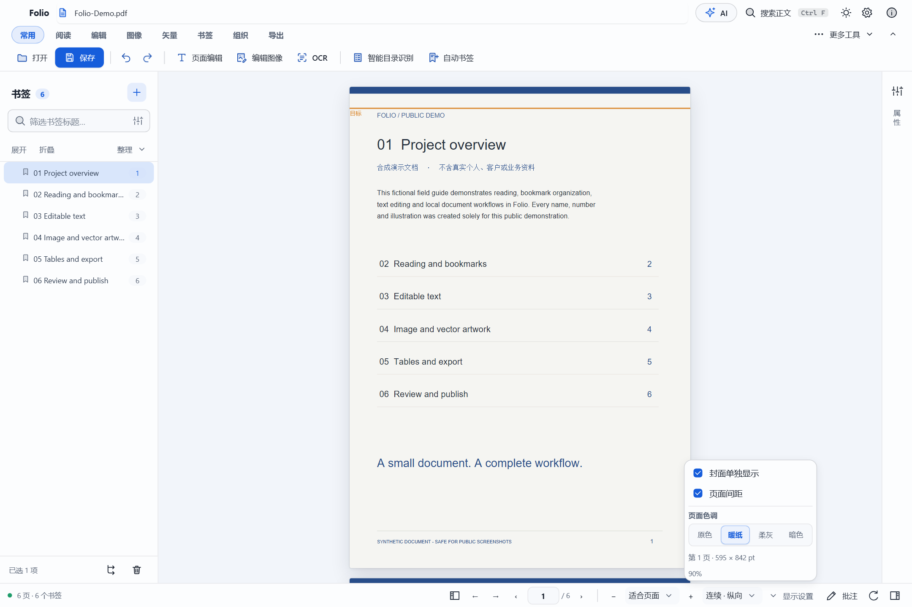
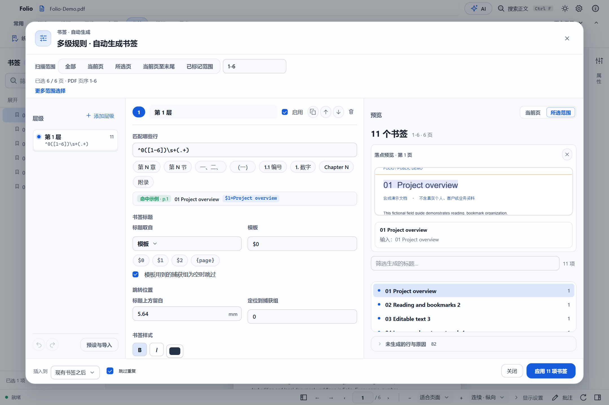

# Folio 2.8.4 實際介面圖解

[English](SCREENSHOTS.md) · [简体中文](SCREENSHOTS.zh-Hans.md) · [繁體中文](SCREENSHOTS.zh-Hant.md)

開啟六頁的 [Folio 示範 PDF](examples/Folio-Demo.pdf)，即可跟著以下步驟操作。這些畫面取自 Windows 上執行的 Folio 2.8.4 介面算繪程式碼，在 Chromium 測試工作階段以簡體中文介面擷取。點選圖片可查看原圖。

[使用指南](../README.zh-Hant.md) · [完整功能圖解](FEATURES.zh-Hant.md) · [發行說明](RELEASE-2.8.4.zh-Hant.md)

## 用鍵盤尋找指令

按 **Ctrl+Shift+P**，輸入「书签」。用方向鍵選取指令，按 **Enter** 執行。按 **Esc** 即可收起面板，返回目前的文件。


## 直接跳到搜尋結果

按 **Ctrl+F** 搜尋 `Folio`，展開結果清單。每一列會顯示頁碼與相鄰文字，點選即可跳到相應段落。圖中共有九處符合，頁面已標示第一處。


## 在原位編輯段落

翻到第 3 頁，進入頁面文字編輯，點選一個可編輯段落。在使用中的文字方塊輸入，完成編輯，再儲存 PDF。重新開啟副本後，可搜尋替換後的文字進行核對。截圖呈現的是輸入階段。


## 切換閱讀色調

開啟右下角的檢視選項，選取頁面色調。圖中已選暖色紙張，可觀察紙面色彩的變化。切回原色即可查看文件原有的配色。



## 檢查書籤的跳轉位置

開啟「書籤 → 多層規則・自動產生書籤」，在第 1–6 頁試用 `^0([1-6])\s+(.+)`。點選預覽中的項目，核對目標頁和標題位置，再套用規則。本例得到 11 處符合，因為目錄項目和章節標題都可能符合規則。



## 在頁面上逐筆校對 OCR

在 OCR 的「校對」頁籤點選一列，即可定位頁面上的相應區域。核對文字，視需要修改並確認，再套用文字層。圖中四筆預設結果示範了如何選取項目和辨識信心指標。可對照 [2.8.3 本機實際辨識截圖](images/2.8.3/13-ocr-review.png) 和對應的[示範掃描檔](examples/Folio-Demo-Scan.pdf)。


## 截圖來源與驗證

指令面板、搜尋結果、閱讀色調、書籤規則與 OCR 校對這五項操作均有對應的 [2.8.4 桌面介面測試](../tests/ui-polish-284.cjs)。在已備妥相依項目的 Windows 工作副本內，將 `FOLIO_EXE` 指向候選版本的執行檔，設定輸出目錄 `FOLIO_AUDIT_OUT`，再執行 `node tests/ui-polish-284.cjs`，即可採用獨立設定檔開啟示範 PDF 並擷取這些介面。

公開示範文件由指令碼產生，內文、數值、書籤、表格及插圖均為範例內容。2.8.4 圖庫採用這份素材。圖片清單記錄每張 WebP 的實際尺寸和 SHA-256。儲存後的頁面算繪、Reader XI 相容性與耗時可查看發行驗證。

[範例產生指令碼](../scripts/docs-fixtures.py) · [2.8.4 圖片清單](images/2.8.4/manifest.json) · [發行驗證](VALIDATION-2.8.4.zh-Hant.md)

## 重現 2.8.3 歷史截圖

2.8.3 的 13 張 PNG 取自 Windows 建置 `fe5b6a7b52350e908da9009142bb68129f7f09c2`。擷取時的檢視區為 1440 × 960，縮放比例為 1，並使用減少動態效果設定及獨立的 Folio 與 Chatbox 設定檔。影像與向量工作室呈現本機工具的實際結果，Word 匯出與列印畫面顯示執行前的設定，OCR 畫面則於本機引擎辨識出文字後擷取。

在獨立簽出的歷史文件版本 `99527c9` 中，依開發指南備妥本機執行環境、OCR 模型及嵌入式編輯器，再從該目錄執行下列指令。

```powershell
native/runtime/python.exe scripts/docs-fixtures.py
node scripts/docs-screenshots.cjs
node scripts/check-docs.mjs
```

歷史擷取指令碼輸出至 `docs/images/2.8.3/`，暫存設定檔位於 `tests/output/`。細節圖可以 `node scripts/docs-screenshots-detail.cjs` 單獨擷取。重新擷取後，先逐張檢視，再用該文件版本的檢查工具更新清單。清單含有 13 張 PNG 與兩份示範 PDF 的雜湊值。

[開發指南](DEVELOPMENT.md) · [2.8.3 圖片清單](images/2.8.3/manifest.json) · [典藏時的擷取指令碼](https://github.com/ionize1080/Folio/blob/99527c9e0e68166489064a63814f454341b5c798/scripts/docs-screenshots.cjs)
