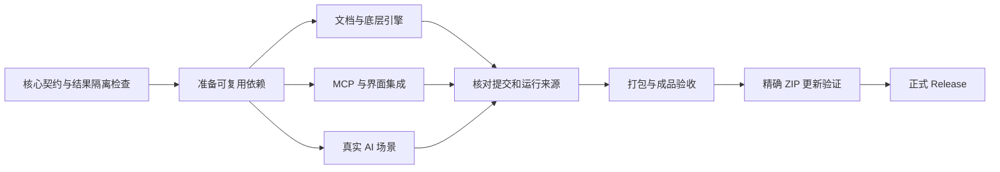

# Folio 并行验收与发布

本流程只服务于 Folio 的构建、测试与发布。采用 GitHub 标准托管运行器，不使用大型付费运行器、不改变缓存付费上限，也不使用多账号、多仓库或循环触发规避额度。

最多同时运行三组 Windows 验收，低于 GitHub Free 标准运行器的并发限制。每组运行在独立虚拟机中，测试配置、输出文件和临时 PDF 不跨组共享。真实 API 测试集中在一个组，避免分组后放大外部服务并发。

| 关卡 | 主要内容 | 失败后的处理 |
| --- | --- | --- |
| Core contracts | 单元检查、源码归档规则、报告来源隔离测试 | 重跑核心关卡及其依赖 |
| Prepare reusable dependencies | 锁定依赖、模型、Chatbox 与 PDF MCP 中间构建 | 重跑准备关卡 |
| Documents and native engines | Windows 底层回归、Office 转换、PDF/A、图层、标签、字体、合并与相关界面 | 仅重跑此组及发布关卡 |
| MCP and UI integration | 完整上游 MCP 回归、续跑保护、设置、窗口与对话集成 | 仅重跑此组及发布关卡 |
| Real AI scenarios | 真实模型转换、同一对话实时上下文、编辑、OCR 和图像生成 | 仅重跑此组及发布关卡 |
| Verify final package and publish | 成品程序、实际 ZIP 更新、校验和、正式发行 | 仅重跑成品发布关卡 |

同一提交可以使用 GitHub 的 **Re-run failed jobs**，保留已经成功的其他组结果。代码发生变化后启动新的验证，不把旧版本测试结果当作新版本通过。新运行会取消过期运行；发布前还会核对 main 的最新提交，避免发布已经被后续修改替代的构建。

缓存只包含可重新下载或重建的依赖与中间构建，不包含测试结果、用户配置、API 密钥或最终发行包。依赖按锁定校验和恢复，中间构建以输入指纹命名并校验文件清单。缓存未命中会正常重建；校验失败会阻断使用。仅准备关卡保存缓存，且保守估算总占用不超过 8 GiB；不会提高付费缓存容量。

测试组通过 GitHub 原生 job outputs 传递小型结构化结果，每组传输限制为 24,000 字符，并校验组名、提交、工作流运行编号、报告集合与通过状态。结果来源错误、报告缺失或失败都会阻止发布。最终验证报告随正式 Release 保存。默认不上传大型 Actions artifacts；截图与临时构建在运行器回收时释放。

正式发行前先创建草稿并核对所有上传文件的 SHA-256，全部上传验证完成后才公开。发布脚本不会替换已发布版本。

GitHub 规则核对日期：2026-11-07。公开仓库使用标准托管运行器的计算免费，缓存和产物有各自额度；历史存储删除只减少后续占用，不冲销已经累计的计费。账户其他仓库、Packages 或服务的用量不由本工作流控制。

- [Actions 使用条款](https://docs.github.com/en/site-policy/github-terms/github-terms-for-additional-products-and-features#actions)
- [Actions 计费与存储说明](https://docs.github.com/en/billing/concepts/product-billing/github-actions)
- [Actions 限制](https://docs.github.com/en/actions/reference/limits)
- [依赖缓存与产物的适用范围](https://docs.github.com/en/actions/concepts/workflows-and-actions/dependency-caching)
